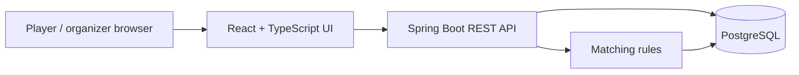
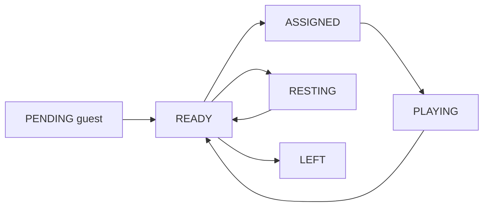
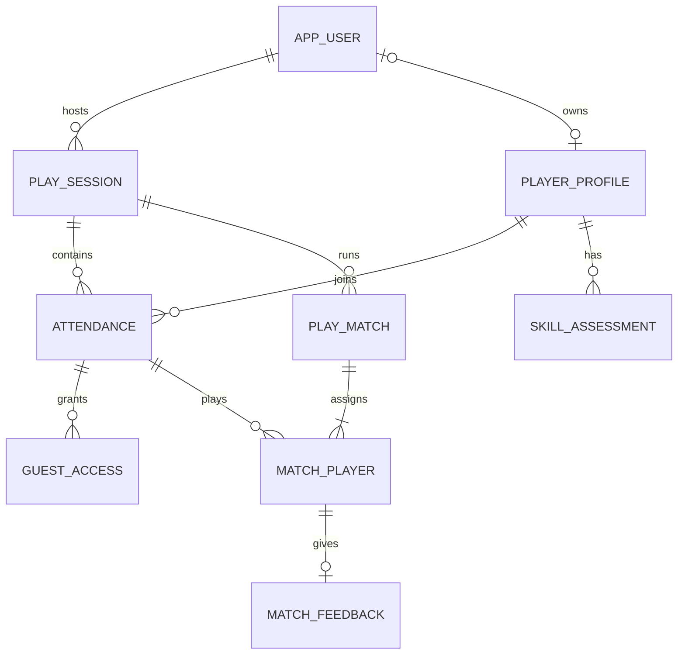

# FairCourt — product blueprint + MVP implementation spec v0.4

**Working concept:** a responsive web app that helps office badminton groups and drop-in players form enjoyable doubles matches without relying on a self-declared “pro” label. Build the normal web version first; consider an installable or native app after the pilot.  
**Owner's working assumption:** build a small, real product for a pilot group first; the 20-minute badminton presentation remains a separate talk, and the app is only a short demo.  
**Core promise:** “Join a session. Find a fair game. Keep playing.”

## 0. START HERE — autonomous local-build handoff

**Instruction to a coding agent:** Build the FairCourt **MVP** in this file as a working local web application. Create the repository, implement backend/frontend/database, run it, fix failures, and hand over a usable local URL. Do not stop after generating code or explaining a plan. Do not build modules 2–4 (venue booking, live tournament, swing video) yet. The 20-minute badminton presentation is a separate artifact.

This file is a scoped implementation contract, **not a promise that an arbitrary AI or environment can finish it without errors**. The agent must have filesystem and terminal access, dependency/build tooling, and a working container runtime for the one-command path. It should make small ordinary implementation decisions itself and record them in `README.md`; ask the user only if a truly blocking choice cannot be inferred from this file. The implementation is complete only when the acceptance flow below passes on local.

**Source of truth when wording differs:** this section's local delivery contract → Part II (sections 11–17, exact MVP behavior) → Part I (product intent and roadmap). Do not silently broaden MVP based on the future-module table. Keep player data private and host mutations host-only, even if a shortcut would make the demo easier.

### Local delivery contract

| Item | Required behavior |
|---|---|
| Run command | From repository root: `cp .env.example .env` once, then `docker compose up --build -d`. The application opens at `http://localhost:5173`. Provide `docker compose down` to stop it; do not delete the database volume by default. |
| Services | `postgres`, `backend`, `frontend` in `compose.yaml` with health checks/start ordering. Frontend is a normal responsive website. Vite proxies `/api` to backend during local development, so browser cookies and calls use the same origin. |
| Health | `http://localhost:8080/actuator/health` reports UP after Flyway migrations and DB connection. Browser root and sample public session page load without a blank screen. |
| Local config | `.env.example` contains **development-only** values, including DB settings and demo login. The real `.env` is git-ignored. `COOKIE_SECURE=false` on plain HTTP localhost; `true` with HTTPS outside local. Guest/account cookies remain HttpOnly and SameSite=Lax. |
| Seed | A local-only, idempotent seed creates one host account, one OPEN sample session with 2 courts, and 8 READY member players with varied skill bands. Restarting services does not duplicate them. A guest is created through the real join flow, not by pretending a seeded account is a guest. |
| Demo login | Local host: `host@faircourt.local` / `FairCourtDemo!1`. The public sample code/link is printed in README and/or startup output. Credentials are never used outside local/demo. |
| Versions | Choose mutually compatible **stable** JDK, Spring Boot, Node, React, Vite and PostgreSQL versions when implementing; pin them in Maven files, `package-lock.json`, Dockerfiles and Compose image tags, and list versions in README. Do not use floating `latest` image tags. |
| API/auth | Keep `/api/v1` routes from section 13. Add `GET /api/v1/auth/csrf` as a public CSRF bootstrap for browser writes and document the exact request header in README. Do not disable CSRF globally to make forms pass. |
| Repository | Root `compose.yaml`, `.env.example`, `.gitignore`, `README.md`, `backend/`, `frontend/`; include migrations, seed, tests and lockfiles. `README` states how to start, log in, use the sample public link, test, stop and reset demo data. |

If Docker cannot run in the agent's environment, implement the project and provide a second documented route (PostgreSQL locally, backend command, frontend command). State plainly which commands were **actually executed** and which could not be verified; do not claim local usability without a successful run.

### Required end-to-end demonstration

1. Anonymous browser opens the sample public page and sees time, venue and two courts, with no names or personal assignments in the response.
2. Host logs in and sees eight Ready players. A separate/private browser opens the public link, joins as guest, and sees **Waiting for host approval**.
3. Host approves the guest, requests suggestions, may swap a player, and confirms one four-player match on Court 1. The host sees all four; the guest sees **only** their own match number, Court 1 and `PLANNED` status if selected. If the suggestion did not select the guest, the host swaps them in before confirming.
4. Host starts and finishes that match. The guest's own page changes status after refresh; the host can suggest another match. Four selected attendees are never assigned elsewhere simultaneously.
5. An anonymous request and a different signed-in player's request cannot read the guest's assignment or call host write routes. An invalid/stale host confirmation receives a useful `409`, not a half-written match.
6. Restart Compose without deleting volumes: the session and finished match remain. Host and guest pages still load. Guest browser cookie remains valid until its configured expiry.

Run meaningful automated checks: backend matching rules and authorization/DB integration tests, frontend build, and at least one browser or HTTP-level smoke test of the host/guest flow. Check 375px phone and desktop layouts visually when browser tooling is available. Record commands and pass/fail results in the final handoff. A complete handoff includes the **local URL, sample public URL/code, demo host credentials, exact start/stop commands, what was verified, and any remaining limitations**. If a gate fails, fix it before calling the work done.

## 1. What problem are we solving?

An after-work group may have regulars, first-timers and visitors. A visitor may not know their own level; another may overestimate it. Someone has to form four-player courts, balance the two teams, avoid leaving people on the bench, and explain why a proposed match makes sense. Doing this in chat becomes awkward as the group grows.

FairCourt starts with **doubles matchmaking during one play session**. “Fair” means a reasonable level spread, balanced teams, reasonable wait time, and an organizer who can override the recommendation. It does **not** mean an objective or permanent ranking of a human being.

### People and jobs

| Person | Main job | First version of the product |
|---|---|---|
| Public visitor | Find and understand the session | View the public session page, time, location, court count and basic status; no personal assignments or private skill details |
| Court host / session owner | Set up an after-work session and keep matches moving | Create a session, invite people, confirm attendees, review suggested courts, **alone assign/change/start/finish matches** |
| Regular player | Join quickly and know where to go | Reuse an account-backed profile, join by link, see **only their own** match, court number and status |
| Drop-in / visitor | Join without an account or embarrassment about skill | Enter a display name, answer a 60-second checklist, appear as **provisional**, and see **only their own** assignment |

Initial pilot: one group, doubles only, roughly 8–24 players and 1–4 courts per session. These are **scope assumptions to validate**, not market facts. No public discovery, payments, physical court inventory or singles optimization in the first release.

## 2. Four-product roadmap, with the easy thing first

| Order | Module | Smallest useful slice | Why now / later |
|---|---|---|---|
| **1** | **Fair Matcher** | Quick level estimate, attendance, suggest four players and balanced pairs, organizer override | The core pain is player mix. A rule-based suggestion can be built and tested without AI or live infrastructure. |
| **2** | After-Work Badminton | Recurring sessions, RSVP, waitlist, per-court time slots, organizer notes | Extend the session shell once people actually use the matcher. Reserving a *group's internal court slot* is different from integrating with a venue's booking system. |
| **3** | Live Tournament | Score entry, fixtures, standings; add live updates if useful | Requires trusted score entry and correction flows. WebSocket becomes useful when multiple viewers need instant updates. |
| **4** | Swing Review | Upload a short clip, draw pose landmarks and let a coach/commenter annotate | A research prototype first. Pose points alone cannot reliably diagnose technique or injury risk; useful feedback needs badminton-specific evaluation and consent for video. |

**Is Fair Matcher the easiest?** The *matching engine* is easier to prototype than a real-time tournament or video coach. The hard part is **calibrating players honestly**. So v1 treats levels as tentative, lets humans correct them, and measures whether the proposed matches feel right.

## 3. MVP: one complete evening

1. Court host creates “Friday Badminton”, selects start/end time and number of courts, then shares a public session link. Anyone can view the public session summary.
2. Regular signs in and joins. Visitor opens the link, chooses a display name, and answers a short skill checklist. Organizer can approve a visitor.
3. Only the host sees the full `Pending`, `Ready`, `Assigned`, `Playing`, `Resting`, and `Left` board and can tap **Suggest next matches**.
4. Web proposes a group of four per available court, then two pairs. It shows a small explanation: “similar experience, balanced teams, Mai has waited longest.”
5. Only the host taps to swap players or accepts. Each player sees their own “Next match / Court 2” view, not the complete host board or another player's private assignment.
6. Only the host taps **Finish**. The app saves who played together and who waited. Scores are optional and do not automatically dictate a skill level.

**MVP acceptance:** with 12 seeded players, 2 courts and 4 visitors, a host can build the first round in under a minute after attendance is marked; can override any suggestion; no one is silently assigned to two simultaneous matches; a visitor remains visibly provisional to the host; a finished match affects the next rotation. A player can retrieve their own court and match, while an unrelated viewer cannot read the same personal assignment through the API. “Under a minute” is a product target to verify in pilot, not a claimed benchmark.

### Visibility and permission contract

| Action / information | Anyone | Joined player | Court host |
|---|---:|---:|---:|
| View public session page (time, venue, number of courts, basic status) | Yes | Yes | Yes |
| Check in as a player | Via join flow | Yes | Can assist |
| View **own** match number, court number and start status | No | Yes | Yes |
| View another player's assignment, private skill evidence or full ready pool | No | No | Yes |
| Generate suggestions; assign, swap, start or finish a match | No | No | **Yes, only host** |

Here “court host” is the person running **this play session**, not necessarily the commercial owner of the venue. The public page should not reveal the complete roster. An individual player must have a reliable identity before the backend returns “my match”: a signed-in account for regulars, or a **private per-guest cookie issued after check-in**, distinct from the public session link. Never use a nickname or a shared session code alone as proof of identity. Apply ownership checks in the Spring API as well as hiding controls in the UI.

**Explicitly later:** AI rankings, Elo from doubles wins, peer voting, venue booking APIs, payment, chat, public leaderboards, injury advice, video analysis, Kafka, Redis, microservices.

## 4. Skill calibration without the “I am advanced” trap

Use **four local bands**, not a sport-wide certification. Avoid humiliating labels or an exposed numerical ranking. In the MVP the host sees the private band and evidence status for matching; the player-facing page stays focused on their own match/court. A fuller player profile can come later.

| Band | Observable description for doubles |
|---|---|
| **Starter** | Learning serve/return and basic positioning; rallies end quickly. |
| **Developing** | Can serve, keep a short rally and reach many ordinary shots; still misses rotations or spacing. |
| **Steady** | Keeps rallies going, changes placement and generally covers the right space with a partner. |
| **Strong** | Handles pace and placement consistently, adapts with a partner and recognizes opportunities. |

The onboarding checklist asks about **observable behavior**, not “Are you good?” Example prompts: “How often does your serve land in?”, “Can you sustain a rally with players at your usual level?”, “When your partner is at the net, do you know where to cover?”, “How comfortable are you moving backward and recovering?” Provide concrete answer anchors such as *still learning / sometimes / usually / consistently*. The self-report yields a **provisional band**, never a certified score.

After 2–3 games, the host can record a short, private observation on serve/return, rally consistency, movement and doubles positioning, then confirm or adjust one band. If a player disagrees, the host can review it in person during the pilot; an in-app request/reason-history flow is later. Do not automatically downgrade someone after one loss: doubles outcomes depend on partners and opponents. Visitors with uncertain levels should enter a court with a manageable range and host attention. Store a simple status: `SELF_REPORTED`, `OBSERVED`, `CONFIRMED`; no opaque confidence percentage in the MVP.

For the pilot, ask each player a **one-tap match fit** question after a game: *Too easy / About right / Too hard*. This is feedback on the **match**, not a public vote on someone's ability. The host remains the decision-maker and can separately record why they overrode a suggestion.

## 5. Matchmaking rules v1

The algorithm makes **recommendations**. It is deterministic enough to explain and test.

1. Eligible pool = checked-in `READY` players who are not in another unfinished match; use currently free courts.
2. For the available `4 × freeCourts` places, choose players with fewer games this session first, then those who have been ready longer. This gives people who sat out the previous round a turn.
3. Sort the selected players by provisional/confirmed level band and group adjacent fours onto courts. Unknown level is temporarily treated as band 2 for calculation and flagged to the host. Flag any wide level spread.
4. Each group of four has only three unique ways to form two doubles teams. Choose the split with the smallest difference between team band sums, then penalize recent repeat partners.
5. Show the suggested court and **why**. Host may swap players or regenerate. Only confirming a proposal saves a planned match.

Example: bands `[Starter, Developing, Steady, Strong]` can split into equal team sums, but the court still has a large level spread. Therefore the algorithm scores **court compatibility first**, then **team balance**. If only four people are available, it can still recommend the least uneven pairing with a visible “wide level range” note. There is no promise of mathematical fairness.

For the MVP, selecting the people who have played least, then grouping nearby bands, is easier to explain and test than a global optimizer. It may miss a better arrangement; compare host overrides and post-match feedback during the pilot. Prefer useful reasons over pretending a decimal score is precise.

**Edge cases to design up front:** fewer than four ready players; odd total; no one near a visitor's provisional level; player arrives late/leaves early; organizer starts a match then cancels; manual pairings; a player selected in one court must not appear in another. Basic state and database validation still matter even though advanced concurrency is outside MVP scope.

## 6. UI and design system

**Personality:** sporty, friendly, focused. Think after-work club, not a betting dashboard or a corporate admin console. Most actions happen on a phone beside the court, with sweaty hands and a short attention span.

### Visual tokens (proposal)

| Token | Value | Use |
|---|---|---|
| Deep navy | `#10202A` | Body text and navigation |
| Court green | `#157B63` | Primary actions, active court |
| Fresh mint | `#DDF7E8` | Soft highlights and success panels |
| Shuttle yellow | `#F9C94D` | Session/next-match accent; not small body text |
| Warm off-white | `#F7F8F4` | Page background |
| Error | `#B64243` | Conflicts and failed actions |
| Typography | `Inter` or system sans | Clear numerals and compact labels; 16px minimum for body on mobile |
| Radius/spacing | 12–16px cards; 8px spacing grid | Friendly, easy to scan |

Use generous white space, strong contrast, one primary action per screen, visible text labels alongside colored status, and 44px-ish touch targets as a practical design goal. Verify foreground/background contrast against WCAG 2.2 when implementing; decorative yellows should not carry essential meaning on their own. Animations should be quick and optional: a subtle “court formed” transition, not constant moving shuttlecocks.

### Screens and copy

| Screen | Main content | Primary action |
|---|---|---|
| **Public session page** | Tonight's time, location, number of courts and basic status; no private lineup | `Join session` |
| **Visitor check-in** | Nickname, four behavior questions, provisional explanation | `Join as guest` |
| **Host board** | Full Pending, Ready, Assigned, Playing, Resting, Left pool; court cards; waiting-time chips; host only | `Suggest matches` |
| **Match review** | Court 1: Team A vs Team B, four player cards, simple reason tags, swap control | `Start match` |
| **My game** | Only this player's match number, court number and status; private match-fit prompt afterward | `View my court` / `How was the match?` |
| **Player profile — later** | Own band, assessment history and review request | Out of MVP |

On mobile web: the MVP has `Tonight` and `My game`; the host gets a separate `Manage` entry. On desktop: a wider host board with courts beside the ready pool. For an English demo, keep interface copy plain: “You're in”, “Your next match: Court 2”, “This match may have a wide skill gap.” Localized Vietnamese copy can follow.

**Host-board composition:** top strip with tonight's session; one large green “Suggest matches” button; horizontal court cards with A/B teams and level chips; below, people waiting longest. **Player-view composition:** one prominent “Your next match / Court X” card, current status and a brief arrival instruction. No crowded analytics charts in v1.

## 7. Technology: intentionally boring and extendable



| Layer | Pick for MVP | Why |
|---|---|---|
| Frontend | React + TypeScript + Vite | Fast SPA workflow, typed UI states; familiar enough for a Java backend developer to learn gradually. |
| Styling | Tailwind CSS with explicit design tokens and a small in-house component set | Rapid consistent screens; avoid a large custom design-system package at this stage. |
| Backend | Java + Spring Boot, REST, one deployable application | Fits owner's Java/Spring experience; clear controllers, services and repositories. |
| Data | PostgreSQL + Flyway migrations; Spring Data JPA for routine CRUD | Relational session, people and match data; reproducible schema evolution. |
| Access | Seeded host/regular accounts for closed pilot; individual guest cookie after check-in; server-side session cookies for accounts | Public session link grants public view only. Public account signup, email recovery and cross-device guest recovery come later. |
| Dev | Docker Compose for DB and app locally; GitHub Actions for build/tests when repository exists | Repeatable environment without Kubernetes. |

Suggested modules within the one Spring application: `identity`, `sessions`, `players`, `assessments`, `matches`, `matching`. Keep the pure matching calculation separate from controllers and persistence so it is easy to test. No Redis/Kafka/WebSocket in v1; add WebSocket only when live scoring genuinely needs it. A responsive mobile browser can use ordinary REST and refresh at key actions for the first pilot. Once the flow works, an installable PWA can be considered without committing to native Android/iOS work; a native client could later reuse the REST API.

**Core entities:** `app_user`, `player_profile` (member or guest), `skill_assessment`, `play_session`, `attendance`, `guest_access`, `play_match`, `match_player`, `match_feedback`. The exact columns, constraints and relationships are in Part II. Recent partner history can be queried from finished matches. Guest identity is not inferred from a matching nickname. Store only necessary personal data; videos arrive much later behind explicit consent and a retention policy.

**API source of truth:** the endpoint and payload contract is in Part II, section 13. In particular, the public summary, the player's own `/sessions/{id}/me` response and the host board use **separate DTOs**. Only the host sees suggestions or creates matches. No generic player-ID assignment endpoint exists.

**Tests that earn their keep:** pure matching unit tests for the three team splits, wait priority, wide skill spread and repeat partners; one Spring/PostgreSQL integration flow for join → suggest → start → finish; authorization tests for public view, host-only writes, own assignment allowed and other-player assignment denied; one browser happy-path test on a phone-sized viewport. Even without a full concurrency feature, validate that a player cannot be in two active matches.

Useful official references for implementation: [Spring MVC](https://docs.spring.io/spring-framework/reference/web/webmvc.html), [Spring Security authorization](https://docs.spring.io/spring-security/reference/servlet/authorization/authorize-http-requests.html), [Spring Boot health](https://docs.spring.io/spring-boot/api/rest/actuator/health.html), [React with TypeScript](https://react.dev/learn/typescript), [Vite proxy](https://vite.dev/config/server-options), [Tailwind with Vite](https://tailwindcss.com/docs/installation/using-vite), [PostgreSQL constraints](https://www.postgresql.org/docs/current/ddl-constraints.html), [Docker Compose up](https://docs.docker.com/reference/cli/docker/compose/up/), [MDN on cookies](https://developer.mozilla.org/en-US/docs/Web/HTTP/Guides/Cookies), [WCAG 2.2](https://www.w3.org/TR/WCAG22/), [MDN on installable PWAs](https://developer.mozilla.org/en-US/docs/Web/Progressive_web_apps/Guides/Making_PWAs_installable).

## 8. Delivery plan for a solo, part-time build

| Milestone | Deliverable | “Done” check |
|---|---|---|
| **0 — Discovery (3–5 evenings)** | Talk to 1–2 organizers and 5–8 mixed-level players; map a real session; sketch 3 key screens | Confirm the pain and what “a fair match” means locally; note exceptions. |
| **1 — Walking skeleton (week 1)** | Repository, responsive React shell, Spring API, migrations, public page, seeded demo group | Run locally with one command; public view reveals no personal assignments. |
| **2 — Complete core loop (week 2)** | Guest check-in, private provisional level, host ready pool, first match suggestion, host swap/confirm, own-assignment view | 12 demo players become two courts; host sees explanations; each player sees only their own match/court. |
| **3 — Rotation and polish (week 3)** | Host start/finish, wait priority, partner history, mobile-web UI, access checks and empty/error states | Second round respects wait and repeats; a player cannot call host endpoints or read someone else's assignment. |
| **4 — Pilot (week 4)** | Small live group trial, usability fixes, deployment to a private URL | At least one organizer can run an evening without a spreadsheet; collect match-fit and override feedback. |

Weeks are **planning estimates**, not commitments. If working only some evenings, allow 4–6 weeks. At each milestone keep the app runnable rather than finishing all frontend first and backend later.

### Pilot learning metrics

- Time from all players checked in to first accepted court proposal.
- Percentage of suggestions the organizer edits; log the reason (`level`, `wait`, `partner`, `other`).
- Percentage of post-match answers marked `About right`.
- Longest time a Ready player waited between matches, in minutes.
- Percentage of guests who complete check-in without organizer assistance.

Set baselines from the first two pilot evenings, then decide whether to change the level rubric or the matching rules. A high override rate is product feedback, not a failure to hide.

## 9. Demo and presentation boundary

Keep the original **20-minute English badminton talk** focused on basic rules, safer movement, equipment choices and beginner confidence. Give this app a **roughly 90-second to 2-minute cameo** near the end: “Our office group often has mixed skill levels. I built a small web demo that suggests fair doubles matches. Players can join as guests, and the organizer stays in control.” Show one screen with a visitor joining and one suggested court. Do not spend the talk explaining databases or system architecture unless the audience specifically asks.

For a separate developer portfolio/demo, use a longer technical story: provisional skill → explainable matching → human override → observed feedback → the four-module roadmap.

## 10. First decisions to validate with actual users

1. Is the pilot mainly **social doubles**, competitive doubles, or a mix? (This plan defaults to social doubles.)
2. Do organizers know most visitors, or do unknown drop-ins arrive regularly? This affects approval and identity.
3. How many courts and players are usual in one evening? This checks the matching approach.
4. Are mixed doubles or gender-based constraints relevant to this **specific group**? Do not infer them from gender; make format preferences explicit later. An inclusive v1 matches by level and availability.
5. Would players rather see their provisional band privately, or only see suggested opponents? Test which feels comfortable.

The very first coding ticket after discovery: **make a seeded 12-player session and a pure Java function that returns two explained doubles pairings**. This tests the actual product idea before adding infrastructure.

---

# Part II — Implementation contract for MVP v0.3

This part turns the product blueprint into decisions a developer can implement. It specifies the **MVP only**: one host per session, social doubles, 1–4 numbered courts, a responsive website, and a small pilot group. It does not specify the later tournament, venue booking or video modules. Product assumptions still need a real-court pilot; “implementation-ready” does not mean a guarantee that no feedback will change the design.

## 11. Fixed behavior and state transitions

| Item | Decision for first release |
|---|---|
| Public access | A random public code opens a read-only session summary. It exposes no roster, skill bands, matches or guest tokens. |
| Host | Any signed-in account may create a session; the creator is its sole host. Host authority is checked by `play_session.host_user_id`, not a global `ADMIN` flag. |
| Regular player | Signed-in, pilot-provisioned account with one player profile; joins a session once and reads only its own attendance/assignment. Public self-signup is out of MVP. |
| Guest | Joins from the public page with a display name and questionnaire; receives a session-scoped, private browser credential. Guest is `PENDING` until host approval. |
| Match | Host accepts a suggestion or chooses four players manually. This creates a `PLANNED` match, then host starts and finishes it. Suggestion itself writes nothing. |
| Court | `court_no` is an integer 1…`court_count` within this session. It is an internal play slot, not a third-party venue booking. |
| Score | No score entry or ranking from wins in the MVP. A completed match records participants and time only. |
| Privacy | Player response contains only their own attendance status, match number, court number and match status. No opponent list, skill band or full court board in player/public APIs. |

Attendance state machine:



Regulars enter as `READY`; guests enter as `PENDING` and the host approves them. Cancelling a planned match changes `ASSIGNED → READY`; cancelling an active match changes `PLAYING → READY`. Host may set `READY ↔ RESTING`. To mark an assigned/playing player `LEFT`, the host first cancels or finishes that match. Finishing a match changes all four players to `READY`, increments `games_played`, and resets their `available_since`; players who waited retain their earlier `available_since` and get priority next round.

Match states: `PLANNED → ACTIVE → FINISHED`, with `PLANNED → CANCELLED` and `ACTIVE → CANCELLED` allowed. A closed session allows read-only history and no new assignments. The UI must show `ASSIGNED` separately from `PLAYING`.

## 12. Database contract (PostgreSQL)

### Relationship map



`player_profile` is the person-like record; `attendance` is that player **in a particular session**. A guest profile may exist without an `app_user`; guests are not merged across sessions by matching display names. Use UUIDs generated by the backend, UTC `timestamptz`, and Flyway migrations. Pilot events are in Vietnam: display times in `Asia/Ho_Chi_Minh` while storing UTC instants. Below is the intended first migration; split into files if preferred, preserving dependencies and constraints.

```sql
CREATE TABLE app_user (
  id UUID PRIMARY KEY,
  email VARCHAR(254) NOT NULL,
  password_hash VARCHAR(255) NOT NULL,
  created_at TIMESTAMPTZ NOT NULL DEFAULT now()
);
CREATE UNIQUE INDEX ux_user_email_ci ON app_user (lower(email));

CREATE TABLE player_profile (
  id UUID PRIMARY KEY,
  user_id UUID UNIQUE REFERENCES app_user(id),
  kind VARCHAR(10) NOT NULL CHECK (kind IN ('MEMBER','GUEST')),
  display_name VARCHAR(80) NOT NULL CHECK (length(trim(display_name)) > 0),
  current_band SMALLINT CHECK (current_band BETWEEN 1 AND 4),
  band_status VARCHAR(15) NOT NULL DEFAULT 'SELF_REPORTED'
    CHECK (band_status IN ('SELF_REPORTED','OBSERVED','CONFIRMED')),
  created_at TIMESTAMPTZ NOT NULL DEFAULT now(),
  CONSTRAINT ck_profile_owner CHECK (
    (kind = 'MEMBER' AND user_id IS NOT NULL) OR
    (kind = 'GUEST' AND user_id IS NULL)
  )
);

CREATE TABLE play_session (
  id UUID PRIMARY KEY,
  public_code VARCHAR(20) NOT NULL UNIQUE,
  host_user_id UUID NOT NULL REFERENCES app_user(id),
  title VARCHAR(120) NOT NULL,
  venue VARCHAR(160) NOT NULL,
  starts_at TIMESTAMPTZ NOT NULL,
  ends_at TIMESTAMPTZ NOT NULL,
  court_count SMALLINT NOT NULL CHECK (court_count BETWEEN 1 AND 4),
  next_match_no INTEGER NOT NULL DEFAULT 1 CHECK (next_match_no > 0),
  state VARCHAR(10) NOT NULL DEFAULT 'OPEN' CHECK (state IN ('OPEN','CLOSED')),
  created_at TIMESTAMPTZ NOT NULL DEFAULT now(),
  CHECK (ends_at > starts_at)
);
CREATE INDEX ix_session_host_start ON play_session (host_user_id, starts_at DESC);

CREATE TABLE attendance (
  id UUID PRIMARY KEY,
  session_id UUID NOT NULL REFERENCES play_session(id),
  player_id UUID NOT NULL REFERENCES player_profile(id),
  state VARCHAR(10) NOT NULL CHECK
    (state IN ('PENDING','READY','ASSIGNED','PLAYING','RESTING','LEFT')),
  checked_in_at TIMESTAMPTZ NOT NULL DEFAULT now(),
  available_since TIMESTAMPTZ NOT NULL DEFAULT now(),
  games_played INTEGER NOT NULL DEFAULT 0 CHECK (games_played >= 0),
  UNIQUE (session_id, player_id),
  UNIQUE (id, session_id)
);
CREATE INDEX ix_attendance_pool ON attendance (session_id, state, available_since);

CREATE TABLE skill_assessment (
  id UUID PRIMARY KEY,
  player_id UUID NOT NULL REFERENCES player_profile(id),
  session_id UUID NOT NULL REFERENCES play_session(id),
  source VARCHAR(5) NOT NULL CHECK (source IN ('SELF','HOST')),
  reviewer_user_id UUID REFERENCES app_user(id),
  answers JSONB,
  band SMALLINT CHECK (band BETWEEN 1 AND 4),
  note VARCHAR(300),
  created_at TIMESTAMPTZ NOT NULL DEFAULT now(),
  CHECK ((source = 'SELF' AND reviewer_user_id IS NULL) OR
         (source = 'HOST' AND reviewer_user_id IS NOT NULL))
);
CREATE INDEX ix_assessment_player_time ON skill_assessment (player_id, created_at DESC);

CREATE TABLE guest_access (
  id UUID PRIMARY KEY,
  session_id UUID NOT NULL,
  attendance_id UUID NOT NULL,
  token_hash CHAR(64) NOT NULL UNIQUE,
  expires_at TIMESTAMPTZ NOT NULL,
  revoked_at TIMESTAMPTZ,
  issued_at TIMESTAMPTZ NOT NULL DEFAULT now(),
  FOREIGN KEY (attendance_id, session_id) REFERENCES attendance (id, session_id)
);
CREATE UNIQUE INDEX ux_active_guest_access ON guest_access (attendance_id)
  WHERE revoked_at IS NULL;

CREATE TABLE play_match (
  id UUID PRIMARY KEY,
  session_id UUID NOT NULL REFERENCES play_session(id),
  match_no INTEGER NOT NULL CHECK (match_no > 0),
  court_no SMALLINT NOT NULL CHECK (court_no > 0),
  state VARCHAR(10) NOT NULL CHECK (state IN ('PLANNED','ACTIVE','FINISHED','CANCELLED')),
  created_at TIMESTAMPTZ NOT NULL DEFAULT now(),
  started_at TIMESTAMPTZ,
  finished_at TIMESTAMPTZ,
  UNIQUE (session_id, match_no),
  UNIQUE (id, session_id)
);
CREATE UNIQUE INDEX ux_busy_court ON play_match (session_id, court_no)
  WHERE state IN ('PLANNED','ACTIVE');

CREATE TABLE match_player (
  match_id UUID NOT NULL,
  session_id UUID NOT NULL,
  attendance_id UUID NOT NULL,
  team CHAR(1) NOT NULL CHECK (team IN ('A','B')),
  released_at TIMESTAMPTZ,
  PRIMARY KEY (match_id, attendance_id),
  FOREIGN KEY (match_id, session_id) REFERENCES play_match(id, session_id),
  FOREIGN KEY (attendance_id, session_id) REFERENCES attendance(id, session_id)
);
CREATE UNIQUE INDEX ux_player_in_unreleased_match
  ON match_player (session_id, attendance_id) WHERE released_at IS NULL;
CREATE INDEX ix_match_players_by_attendance ON match_player (attendance_id, match_id);

CREATE TABLE match_feedback (
  match_id UUID NOT NULL,
  attendance_id UUID NOT NULL,
  fit VARCHAR(10) NOT NULL CHECK (fit IN ('TOO_EASY','ABOUT_RIGHT','TOO_HARD')),
  created_at TIMESTAMPTZ NOT NULL DEFAULT now(),
  PRIMARY KEY (match_id, attendance_id),
  FOREIGN KEY (match_id, attendance_id)
    REFERENCES match_player(match_id, attendance_id)
);
```

**Application invariants:** `court_no ≤ play_session.court_count`; exactly four distinct attendance IDs per match, two per team; all four belong to its session and are `READY` when planned; no other unreleased match for them; host owns the session; feedback comes from a participant after match completion. Enforce these in the service in one database transaction. The partial unique indexes also protect the two most important persisted invariants: one busy match per court and one unfinished assignment per player. On finish/cancel, mark all four `match_player.released_at` and update their attendance states within the same transaction.

Keep the token secret **out of the database**: generate 32 random bytes, send it only in an HttpOnly, SameSite=Lax guest cookie, store SHA-256 of the secret in `guest_access`, and expire it shortly after the session. Use the Secure cookie flag on HTTPS; local plain-HTTP development uses `COOKIE_SECURE=false` as stated in section 0. Guest access is scoped to its recorded session/attendance. In this pilot one browser has one active guest identity; joining the same session again with a valid guest cookie returns the existing attendance. If the cookie is lost, the guest checks in again and the host marks the old attendance `LEFT`; cross-device recovery is later. The shared public code never authenticates a player. Cookie-authenticated writes keep CSRF protection enabled; deploy FE and API under one origin for the pilot.

## 13. API contract and permissions

Prefix all endpoints with `/api/v1`. UUIDs are path identifiers for private endpoints; `publicCode` is the shareable random code. Return ISO-8601 timestamps with timezone. Never accept `hostUserId`, `playerId`, or `attendanceId` from a client as proof of its identity; derive them from the signed-in principal or scoped guest credential.

| Method and route | Caller | Contract |
|---|---|---|
| `GET /public/sessions/{publicCode}` | Anyone | Public title, venue, localizable times, court count, status; no names or match IDs. |
| `POST /auth/login`; `POST /auth/logout`; `GET /me` | Pilot-provisioned account | Cookie-backed account session; `GET /me` returns account identity. Public signup is not available. |
| `POST /sessions` | Signed-in account | Create session; creator becomes host. |
| `POST /public/sessions/{publicCode}/guests` | Visitor | Submit name/assessment; create guest `PENDING`, set private guest cookie. |
| `POST /sessions/{sessionId}/join` | Signed-in player | Join once with member profile; return own attendance. |
| `GET /sessions/{sessionId}/me` | Member or scoped guest | Own attendance state, optional own `matchNo`, `courtNo`, `matchState`; no other players. |
| `GET /host/sessions/{sessionId}/board` | This session's host | Full attendance list, private bands, current matches and courts. |
| `PATCH /host/sessions/{sessionId}/attendance/{attendanceId}` | Host | Approve guest, set Ready/Resting/Left with state validation. |
| `POST /host/sessions/{sessionId}/suggestions` | Host | Compute one or more proposed courts; read-only, no match persistence. |
| `POST /host/sessions/{sessionId}/matches` | Host | Confirm one proposed or manually edited four-player pairing as `PLANNED`. |
| `PATCH /host/matches/{matchId}/start` | Owning host | Planned → active; four attendance rows Assigned → Playing. |
| `PATCH /host/matches/{matchId}/finish` | Owning host | Active → finished; release players, set Ready and update wait/game counters. |
| `PATCH /host/matches/{matchId}/cancel` | Owning host | Planned/active → cancelled; release players and restore Ready. |
| `POST /sessions/{sessionId}/me/feedback` | Participant | Body includes `matchId` and fit answer; verify this identity was in that finished match; one answer per player/match. |
| `POST /host/sessions/{sessionId}/assessments` | Host | Record observation and update current private band. |

Example guest check-in:

```http
POST /api/v1/public/sessions/FRI7Q2K9/guests
Content-Type: application/json

{"displayName":"Mai","answers":{"serve":2,"rally":1,"movement":1,"positioning":1}}
```

Response: `201 Created`, guest cookie set; body `{"attendanceState":"PENDING","message":"Waiting for host approval"}`. If all four answers are unknown, accept `null` values, set `current_band = null`, and show an **Unknown / provisional** badge to the host. Otherwise map the four scores (0–3 each) to a provisional band: total 0–3 → 1; 4–6 → 2; 7–9 → 3; 10–12 → 4. This is a **pilot heuristic**, not a validated badminton rating. Require all four scored answers or all unknown in v1 so partial input does not create misleading precision.

Example host suggestion and confirmation:

`POST /api/v1/host/sessions/{id}/suggestions` response:

```json
{
  "suggestions": [{
    "courtNo": 2,
    "teams": {"A": ["attendance-uuid-1", "attendance-uuid-4"],
              "B": ["attendance-uuid-2", "attendance-uuid-3"]},
    "reasonCodes": ["SIMILAR_LEVEL", "BALANCED_TEAMS", "LONG_WAIT"],
    "warnings": []
  }]
}
```

`POST /api/v1/host/sessions/{id}/matches` request:

```json
{
  "courtNo": 2,
  "teams": {"A": ["attendance-uuid-1", "attendance-uuid-4"],
            "B": ["attendance-uuid-2", "attendance-uuid-3"]}
}
```

Confirmation returns `201` with `matchId`, `matchNo`, `courtNo`, `state: "PLANNED"`. Suggestions may be stale: re-read the four attendance rows and court state when confirming, then return `409 MATCH_CONFLICT` with a friendly retry message if anyone is unavailable. `GET /sessions/{id}/me` returns `{"attendanceState":"ASSIGNED","assignment":{"matchNo":3,"courtNo":2,"matchState":"PLANNED"}}` to that player only, or `assignment: null` while waiting. `GET /host/.../board` may contain names and private bands; it must never be reused as a player response.

Error body: `{"code":"MATCH_CONFLICT","message":"A player or court is no longer available.","requestId":"..."}`. Use `400` invalid payload, `401` missing/expired identity, `403` authenticated but no permission, `404` unknown or private resource not visible, `409` state conflict. Validate field lengths and IDs at the boundary, and show friendly UI messages rather than raw exceptions.

## 14. Match engine contract

Use a pure function, for example `List<Proposal> suggest(BoardSnapshot snapshot)`, where `BoardSnapshot` contains ready attendance IDs, private bands (nullable), `availableSince`, `gamesPlayed`, the last three partners per player, and currently free court numbers. It must not query repositories or mutate attendance. A host can make a manual four-player selection even if the matcher has no good suggestion.

**Deterministic v1 policy:** from a maximum 24 `READY` players, compute `slots = 4 × min(freeCourts, floor(readyCount / 4))`. Sort the ready pool by `gamesPlayed ASC`, `availableSince ASC` (older first), then attendance UUID; take the first `slots`. This favors a player who sat out the previous round. Sort those selected by effective band 1…4, then the same tie-breakers. A `null` band counts as 2 **only for grouping calculation**, with an `UNKNOWN_LEVEL` warning. Split the sorted list into consecutive groups of four, mapping them to free courts in court-number order. This is intentionally a simple heuristic rather than an exhaustive global optimizer.

For each four, test the three unique team splits. Rank splits by `teamGap = abs(sum(teamA) - sum(teamB))`, then by the number of partner pairings seen in the last three **finished** matches for each player, then stable UUID order. Calculate `spread = max(bands) - min(bands)` for each court; if `spread ≥ 2`, include `WIDE_SKILL_GAP`. If fewer than four are ready or no court is free, return no suggestion with `WAITING_FOR_PLAYERS` or `NO_FREE_COURT`. Explanations are generated from these rules, not AI. The host can swap across courts or replace any player before confirming; the API revalidates the final four on each court.

**Boundary tests:** four equal-band players; `[1,2,3,4]` warns about spread even when team sums tie; one unknown; four zero-game players are selected ahead of four one-game players; fewer than four ready; occupied court excluded; two simultaneous courts never reuse an attendance ID; same snapshot returns same ordering. Unit tests assert policy and invariants, not incidental internal implementation.

## 15. Backend code map and transaction boundaries

```text
backend/src/main/java/.../faircourt/
  identity/       AccountController, GuestCredentialResolver, AccessPolicy
  sessions/       PublicSessionController, SessionController, SessionService
  players/        AttendanceController, AttendanceService, SkillAssessmentService
  matching/       MatchSuggester, BoardSnapshot, Proposal, ReasonCode
  matches/        HostMatchController, MatchService, MatchRepository
  common/         ApiError, GlobalExceptionHandler, ClockConfig
backend/src/main/resources/db/migration/V1__initial_schema.sql
backend/src/test/.../matching/MatchSuggesterTest.java
backend/src/test/.../api/SessionAccessIT.java
```

Controller → service → repository; DTOs at the HTTP boundary, domain rules in services/pure matcher, entities inside persistence. Avoid putting matching logic inside a JPA entity or React component. Inject `Clock` for time-dependent session/token logic. The host access policy takes `(principalUserId, sessionId)` and checks the persisted owner for **every** host mutation; Spring Security route rules provide an initial gate, and service-level ownership does the resource-specific check.

`MatchService.confirm(...)`, `start(...)`, `finish(...)`, and `cancel(...)` each run in a single `@Transactional` method. Confirm locks the session row to allocate/increment `next_match_no`, validates court, four distinct ready attendees and team sizes, creates match + assignments and marks `ASSIGNED`; no partial success. Finishing marks match complete, releases four assignments, increments game counts and returns attendees to Ready together. Do not catch a database uniqueness error and pretend the match was saved; map it to `409` and let the host refresh. This is basic data integrity, not a separate high-load booking feature.

Authentication baseline: password hashes through Spring Security's password encoder; account sessions via HttpOnly, SameSite=Lax cookies, with Secure enabled outside local plain HTTP; CSRF token on cookie-authenticated writes; no open CORS wildcard. For the demo, seed accounts. Before wider public signup, add account verification/recovery and abuse controls; these are a rollout gate, not a dependency for a closed pilot.

## 16. Frontend screens, components and responsive behavior

| Route | Data request | Phone layout | Desktop layout | Empty/error state |
|---|---|---|---|---|
| `/s/:publicCode` | Public summary | Hero with time/venue, court count, one Join button | Centered card, max width ~720px | Unknown code → friendly 404; closed → read-only |
| `/s/:publicCode/join` | Public summary + guest POST | Four-step checklist, large answer cards, progress label | Same narrow form | Validation in place; pending approval panel after submit |
| `/my/sessions/:sessionId` | Own assignment | One large Court/Match card, status, refresh hint | Centered card | Pending, Ready/no match, Assigned, Playing, Finished/closed, expired guest access |
| `/host/sessions/:sessionId` | Host board | Court carousel above player status lists; sticky Suggest button | Courts in 2–4 columns beside Ready pool | No ready players, fewer than four, occupied courts, request failure |
| `/host/sessions/:sessionId/review` | Suggestion preview | One court at a time; tap a player then another to swap | Courts side by side; same tap-to-swap works | Wide gap warning, stale suggestion 409, Cancel/Confirm |

The player's page does **not** load the host board then hide fields in CSS. It calls its own small `/sessions/{id}/me` endpoint. Host page does not show player-only feedback as a public statistic. A guest's private credential is kept in an HttpOnly cookie; React never reads or stores the secret. After a host assignment, the player page can poll its own endpoint every 15 seconds while visible and offer an explicit Refresh button; no WebSocket required.

**Component inventory:** `SessionHero`, `QuestionStep`, `StatusBadge`, `CourtCard`, `PlayerChip` (host only), `WaitIndicator` (host only), `MatchProposal`, `SwapSelector`, `MyAssignmentCard`, `EmptyState`, `ErrorBanner`, `ConfirmDialog`. Keep API DTO types in `src/api/types.ts` and route-specific state in each page; a small fetch wrapper handles credentials, CSRF, typed errors and loading. Avoid a global state library until multiple screens genuinely share changing state.

```text
frontend/src/
  api/            client.ts, types.ts, sessions.ts, matches.ts
  components/     Button.tsx, StatusBadge.tsx, CourtCard.tsx, EmptyState.tsx
  features/       public-session/, join/, my-game/, host-board/, match-review/
  routes/         route definitions and access guards
  styles/         tokens.css, globals.css
```

**Design tokens made actionable:** background `#F7F8F4`, surface `#FFFFFF`, text `#10202A`, action `#157B63`, pale highlight `#DDF7E8`, accent `#F9C94D`, error `#B64243`. Use `16px` body, `14px` supporting text, `20px` card title and `28px` page title; 8px spacing increments; 16px card padding on phones, 24px on desktop; max content width 1200px for host, 720px for player; buttons at least 44px high. Under 768px use one column and a compact bottom navigation; at 768px+ use wider court/ready layouts. Show both an icon/text status and a color; check actual color-pair contrast when building. Support keyboard focus and the tap-to-swap flow without drag-and-drop.

**Page-state matrix:** every fetch can be `loading / success / empty / error`; every host mutation can be `idle / saving / success / conflict`. `409` shows “This lineup changed. Refresh suggestions” without discarding the host's whole session. `403` shows “You don't manage this session” and offers the public page. Guest cookie expiry shows “Check in again and tell the host to remove your old entry.” Buttons disable while saving to avoid duplicate taps; the backend still validates writes.

## 17. Build order and delivery gates

1. **Fixture and domain:** write Flyway `V1`, seed a host, 12 attendees with varied bands, and two courts; implement pure matcher plus boundary tests. Gate: deterministic two-court proposal, no duplicate players.
2. **Public + identity slice:** login/session cookie, public summary, guest join with scoped private cookie, host guest approval, `GET /me`. Gate: anonymous sees only public data; guest sees only own state.
3. **Host core loop:** board, suggestion, tap-to-swap, confirm, start, finish, cancel. Gate: correct DB state and `409` on an unavailable player/court; no partial match rows.
4. **Player loop:** assignment page, 15-second visible-page refresh, match status, feedback. Gate: four assigned players each see only their own match/court; a fifth sees no assignment.
5. **Polish and pilot:** responsive phone layout, empty/error states, accessibility pass, private deployment and one real session. Gate: organizer can run two rounds without editing DB or using a spreadsheet.

Keep a simple Compose setup for PostgreSQL, backend and frontend; `README` includes `.env.example`, migrations, seed command, local URLs and demo accounts. CI runs backend tests and frontend build. For persistence and access rules, use a PostgreSQL-backed integration test rather than relying only on an in-memory database. No benchmark, Kafka or cluster deployment is needed for this pilot.

### Scope acceptance checklist

- [ ] Anonymous public response contains no attendance names, bands, match IDs or guest credentials.
- [ ] Host can create a session, approve a guest and see the full board; another account gets 403 on host routes.
- [ ] Member and guest can read their own assignment; neither can query another player's assignment or host board.
- [ ] Suggestions do not persist; confirm persists exactly one four-player, two-team planned match.
- [ ] Court and player cannot be assigned twice while unfinished; finish/cancel releases both.
- [ ] Four players see match number and court number after confirm; public viewers do not.
- [ ] Second round accounts for time spent waiting; host can always override a suggestion.
- [ ] Phone layout works at 320px+; loading, empty, permission, expired access and conflict states are readable.
- [ ] The badminton presentation can demo guest join → host assignment → player view in about two minutes.
