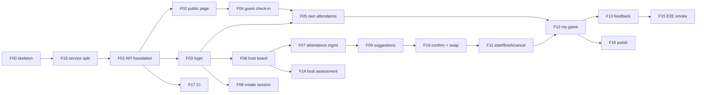

# FairCourt MVP roadmap

Status: PROPOSED (2026-11-17; sprint plan rewritten the same day for microservices, OD-17). Sprint content follows the blueprint §17 build order; open decisions below need the owner.
Board: [README.md](README.md) · System design: [architecture/system-design.md](architecture/system-design.md)

## 1. Where the project is (repository scan, 2026-11-17)

| Area | What exists | What does not exist yet |
|---|---|---|
| Infra | `compose.yaml` (postgres 18.6, backend, frontend; `test` and `tools` profiles), opt-in `compose.backend-dev.yaml`, ports 9090–9093, pinned versions (README) | CI workflow |
| Database | `V1__initial_schema.sql` copied verbatim from §12 | No further migrations |
| Backend | `SecurityConfig` (health public, everything else `denyAll`, CSRF on), `ClockConfig`, `LocalDemoSeeder` (JdbcClient, idempotent, one transaction), `PublicCodeGenerator`, pure `matching/` package (`MatchSuggester`, `BoardSnapshot`, `Proposal`, `ReasonCode`, `Warning`, `SuggestionResult`) | No controllers, services, entities, repositories, error handling, login, guest access |
| Backend tests | `MatchSuggesterTest` (13 cases incl. all §14 boundary tests), `DatabaseSchemaIT` (seed idempotency, busy-court and unreleased-player indexes), context test | Authorization / API integration tests |
| Frontend | Vite + React 19 + Tailwind 4 tokens (`tokens.css` `@theme`), one `HomePage` at `/` | Router, API client, any §16 route, shared components |
| Docs | README (run/test/format/verification log), `API Document/backend.md` + `frontend.md` (status per route = "Not started") | — |

The README verification log shows slice 1 verified on the Mac (2026-11-09) and on Windows WSL (2026-11-12). Nothing was re-run for this roadmap.

## 2. Research: what similar products do

Sources are app-store listings, vendor help pages and marketing pages, so their claims are the vendors' and were not tested. Fetched 2026-11-17.

| Product | What it does that is relevant | Source |
|---|---|---|
| PaQueueKa (iOS) | Host creates a session; players join by a 6-character code or QR without an account; matches built by skill tier, recent partners mixed up, fewer rematches vs. same opponents; finished players go to the back of the queue; late joiners do not jump ahead; host or player can "sit out" without losing their place; queue sortable by "Longest wait", players waiting 20+ min are tagged; host can edit lineups mid-match and fix a skill tier; rotation modes (balanced, FIFO, challenger court); scores, rankings, fees, badges, tournaments in paid tiers | [App Store](https://apps.apple.com/jp/app/paqueueka-badminton-queue/id6770977347) |
| BRL – Badminton Ready List (iPad) | Players check in as "Ready for Game"; sorted by arrival time or break duration; tracks match counts "so everyone gets an equal chance"; suggests the next group | [App Store](https://apps.apple.com/us/app/-/id6608966866) |
| Badminqueue 2 (iPad) | Chooses next players per court, sorts by match count, can match by level and gender; v1.0.4 moved queue logic to a percentage basis and added an on-court timer (search summary; the listing page itself returned 404 when fetched) | [App Store](https://apps.apple.com/no/app/badminqueue-2/id6466697521) |
| Reclub | Clubs with host-run sessions, RSVP, join requests, placeholder "reserve" for players without the app; skill split by court is a club convention, ratings via DUPR integration for pickleball | [Help center](https://help.reclub.co/hc/reclub-help/en/categories/reclub), [FAQ](https://pickleball.reclub.co/faq), [Hosting tips](https://pickleball.reclub.co/blog/10-insider-secrets-to-hosting) |
| Playtomic | Starting level from a one-time questionnaire, explicitly "an estimate"; a reliability indicator (low/medium/high) that starts low; a level set in a certified club session starts at medium reliability | [Level system](https://playerhelp.playtomic.com/hc/en-gb/articles/43310980754193-How-the-Playtomic-level-system-works), [Reliability](https://intercom.help/getplaytomic/es/articles/8625153-the-level-reliability-variation) |
| Reclub community survey (Indonesia padel, 2026) | Reports that only 9% of respondents trust their own self-assessment as the single rating method (single regional sample) | [Survey](https://coolmeets.reclub.co/research/padel-ratings-indonesia-2026-results) |
| PB League (pickleball league) | Weighted pairing optimizer (session partners, sit-outs, sit-out variance, opponents, rank balance, ...); admin can rerun, regenerate part of a round, and edit any pairing manually before "lock & save" | [Feature page](https://pb-league.github.io/league/marketing.html) |
| Padel Americano/Mexicano apps | Americano = everyone partners everyone; Mexicano = standings drive pairings; at least one listing summary reports user complaints about repeated partners and unequal game counts | [Padelmix](https://mwm.ai/apps/padel-americano-padelmix/6505054587), [Americano Padel](https://apps.apple.com/app/id1536633475) |
| Open-source | Court-assignment prototype in Java (no skill balancing seen), a Docker+PostgreSQL badminton tournament planner, an open rating engine | [Badminton-Algorithm-java](https://github.com/Reinyerr/Badminton-Algorithm---java), [tournament planner](https://mfuglsang.github.io/badminton_tournament_planner/?lang=en), [OpenRating](https://badminton.openrating.app) |

### What this means for FairCourt

Already in the blueprint, and the research supports it (no change needed):

- Join by code without an account → guest check-in (§3, §12). A shared code alone is never identity in FairCourt (§3); PaQueueKa's listing does not say how it handles that.
- "Games played first, then waited longest" is what BRL, Badminqueue and PaQueueKa describe → §14 selection order.
- Visible waiting time → `WaitIndicator` (§6). The "tag after N minutes" threshold is not in the blueprint → OD-14.
- Avoid repeat partners → §14 split ranking.
- Human review before saving (PB League "lock & save", PaQueueKa edit lineup) → suggest → swap → confirm (§5, §13).
- A self-assessment is only a starting estimate (Playtomic; 9% trust figure) → provisional band + `SELF_REPORTED → OBSERVED → CONFIRMED` + host observation (§4, F14).

Gaps the research exposed in the blueprint (added as open decisions, not decided here):

- "Sit out without losing your place" vs. FairCourt's `READY ↔ RESTING`: the blueprint does not say whether `available_since` is kept or reset → OD-07.
- Rejecting a pending guest: the §11 state diagram has no `PENDING → LEFT` → OD-15.

Ideas kept for after the MVP pilot (see §6): QR code for the public link, repeat-opponent penalty, rotation modes, fixed pairs, self-service sit-out, offline-tolerant host actions, host-assisted check-in for people without a phone. Fees, rankings, badges, tournaments and mini games stay out (§3 "Explicitly later").

## 3. Planning principles

1. **Runnable vertical slices** (§8): every sprint ends with something demoable through the real UI or HTTP API, tests green, stack starting with `docker compose up --build -d`.
2. **Easy → hard, inside dependency order**: read-only before writes, anonymous before authenticated, single-row writes before multi-row transactions. The hardest feature (F10 confirm) comes after the plumbing it needs is proven.
3. **Foundation once, reuse everywhere**: F01/F02 build error handling, the security route table, the test harness, the API client and the async-state hooks. Later features add a route line, a DTO, a query or service, and test rows; they do not edit the plumbing.
4. **Additive change**: new behavior = new classes, new migration `V<n>`, new rows in `AccessMatrixIT`. Never widen one audience's DTO to serve another (§13).
5. **Privacy first**: each read endpoint selects only the columns its audience may see; tests check response keys against an allowlist (system-design §6, §12).
6. **Decisions before code**: anything the blueprint does not decide becomes an `OD-xx` and blocks only the feature that needs it.
7. **One service boundary at a time** (OD-17): a new service appears in the sprint that first needs it; a new internal route or event is listed in its feature design and approved first.
8. **Backend first, then that feature's frontend** (owner 2026-11-17), before the next feature starts.

## 4. Sprint plan

Timebox per sprint is the owner's call. Blueprint §8 estimates the whole MVP at 4–6 weeks of part-time evenings (an estimate, not a commitment). Difficulty is my estimate.

| Sprint | Features | Difficulty | Blueprint | Gate |
|---|---|---|---|---|
| S00 Foundation | F00 | — | §0, §12, §14, §17-1 | Deterministic two-court proposal, no duplicate players — **DONE** (built as one app; F18 splits it) |
| S01 Services + public read | **F18 Service split skeleton**, F01 API foundation (shared lib + gateway), F02 Public session page (+ price, format, minimum sets) | Hard (F18), Easy (F01, F02) | §0, §13, §16; OD-17…OD-20 | All services healthy with one command; anonymous sees only public data through the gateway; errors, request ID and CSRF bootstrap tested |
| S02 Identity | F03 Account login (gateway session + auth-service), F04 Guest check-in (first saga), F05 Own attendance + member join | Medium–Hard | §11, §12, §13, §15 | Guest sees only own state (§17-2); services accept identity only from the gateway |
| S03 Host board | F06 Host board (sets played vs. minimum), F07 Attendance management, F08 Create session (format, minimum sets, price) | Medium | §3, §6, §11, §13; OD-18…OD-20 | Host creates a session, approves a guest, sees the full board; another account gets 403 |
| S04 Match loop | F09 Suggestions (singles + doubles), F10 Confirm + swap, F11 Start/finish/cancel | Hard | §5, §11, §12, §14, §15; OD-20 | Correct DB state, 409 on unavailable player/court, no partial rows (§17-3) |
| S05 Player loop | F12 My game (own sets played), F13 Feedback in **rating-service**, F14 Host assessment in player-service | Medium | §4, §13, §16 | Assigned players see only their own match/court; others see none (§17-4) |
| S06 Acceptance | F15 E2E smoke through the gateway, F16 Responsive/a11y, F17 CI | Medium | §0, §6, §16, §17-5 | All six §0 steps and the §17 checklist PASS with evidence |
| Later (not scheduled; owner 2026-11-17: discovery comes after one play session works end to end) | Discovery list (L-18), map (L-14), notifications + Kafka, call/chat with host (L-15, L-16), storage (L-13) | — | owner direction | Needs owner decision per item |

Mapping to §17: step 1 = S00 (+ F18 re-proves it on the split services); step 2 = S01 + S02 + guest approval in F07; step 3 = S04; step 4 = S05; step 5 = S06 (local part). The order of the §17 gates is unchanged. Product additions from the owner (singles/doubles, price, minimum sets) are added to the features that already own those screens and rules, not as separate sprints.

F14 (host assessment) and F17 (CI) have few dependencies and can be pulled earlier if a sprint has room.

## 5. Open decisions

Each decision blocks only the features listed. "Recommended" is a proposal; nothing here is decided until the owner says so and it is logged in the feature's decision log (and in `CLAUDE.md` if project-wide).

| ID | Question | Options | Recommended | Blocks |
|---|---|---|---|---|
| OD-01 | Frontend routing for the §16 routes | (a) add `react-router` (exact version checked on npm at implementation time) · (b) small in-house router on `history.pushState` | **DECIDED 2026-11-18: (a)** `react-router`, basic declarative use only (`<Routes>`/`<Route>`/`<Link>`). Latest on npm checked 2026-11-18: 8.5.1 (published 2026-10-27; peer `react >=19.2.7`, engine `node >=22.22.0`); pin exact version when added | F02 |
| OD-02 | How does the browser learn `sessionId` for `/my/sessions/:sessionId`, `GET /sessions/{id}/me` and `POST /sessions/{id}/join`? §13's public response forbids "names or match IDs" and the guest-join example body has no `sessionId` | (a) add `sessionId` to the public summary · (b) only return it from guest/member join · (c) key player routes by `publicCode` (changes §16 routes) | (a): an opaque UUID grants nothing because every private route checks identity; members need it before joining, so (b) alone is not enough | **DECIDED 2026-11-18: (a)** the public summary returns the opaque internal id (named per OD-22) | F02, F04, F05 |
| OD-03 | Login screen route and where a host lands after login (§16 names no login route) | (a) `/login?next=…`, back to `next` or home · (b) login dialog on the home page | (a) | F03 |
| OD-04 | How a host reaches `/host/sessions/:id`. §13 has no "my sessions" route | (a) new `GET /api/v1/host/sessions` (sessions hosted by the caller) · (b) public page shows a Manage link when the caller is the host (adds a field to the public DTO) · (c) URL only from seed log / bookmark | **DECIDED 2026-11-25: (a)** `GET /api/v1/host/games` + "Games you host" on the home page (owner) | F06 |
| OD-05 | Create-session UI: §3 step 1 and §13 `POST /sessions` exist, but §6/§16 have no screen | (a) API + tests only in MVP · (b) small form at `/host/sessions/new` | **DECIDED 2026-11-26: (b)** form at `/host/games/new`, reached from "Games you host" (owner) | F08 |
| OD-06 | Guest cookie lifetime: "expire it shortly after the session" (§12) | `ends_at` + N hours (N = ?) | `ends_at + 12h` as a starting value | F04 |
| OD-07 | `available_since` rules the blueprint leaves open: on `RESTING → READY`, on guest approval `PENDING → READY`, and on cancel | keep the earlier value vs. reset to now, per transition | Approval: keep join time. Resting → ready: keep (PaQueueKa-style "sit out without losing your place"). Cancel: keep (the players did not play). **Approval part DECIDED 2026-11-26: keep** (owner); resting part moot (no Rest button, F07); **cancel part DECIDED 2026-11-27: keep** (owner, Match start / finish / cancel design D-1) | F07, F11 |
| OD-08 | Frontend/browser test tooling | (a) none in MVP; HTTP-level smoke test in Java (no new dependency) · (b) add Vitest for pure UI logic (swap reducer) · (c) add Playwright for a phone-viewport browser test (§7 mentions one) | **DECIDED 2026-11-26: (b) for F10** (owner, Match confirm design D-6): Vitest dev dependency for the swap reducer, version shown before pinning; (c) still optional in F15 | F10, F15 |
| OD-09 | CI: add a GitHub Actions workflow (§7, §17 say CI runs backend tests and frontend build) | approve file + scope | Approve, tests + build only, no deploy | F17 |
| OD-10 | Closing a session (`OPEN → CLOSED`): §11 defines closed behavior, §13 has no route | (a) out of MVP; only seed/DB sets CLOSED, services still enforce read-only · (b) add a host route | **DECIDED 2026-11-26: (a)** out of MVP (owner, Create game design) | F02, F08–F11 |
| OD-11 | May the host also play in their own session? Seed host has no player profile | (a) no in MVP · (b) yes, host joins as member | **DECIDED 2026-11-18: (b)** the owner chose yes, the host joins as a member (differs from the recommendation (a)); the host then needs a player profile (the seed host has none), settled in the Own attendance status design | F05, F06 |
| OD-12 | Version label: title says v0.4, Part II says v0.3 (existing open question in `CLAUDE.md`) | — | — | none |
| OD-13 | What the public page's `Join session` button does before guest check-in (F04) ships | (a) visible but disabled with "Coming soon" (same pattern as the home page's Host login) · (b) hidden until F04 | **DECIDED 2026-11-18: (a)**, owner: visible and disabled | F02 |
| OD-14 | Wait indicator on the host board: minutes only, or a highlight after N minutes? | minutes only · highlight after N | **DECIDED 2026-11-25: minutes only** (owner) | F06 |
| OD-15 | Can the host reject a pending guest (`PENDING → LEFT`)? Not in the §11 diagram | allow · do not allow | **DECIDED 2026-11-26: allow** (owner), so a mistaken or duplicate check-in can be cleared | F07 |
| OD-16 | How does a player learn the `matchId` that `POST /sessions/{id}/me/feedback` requires? `/me` lists `matchNo`, `courtNo`, `matchState` only | (a) add own `matchId` to the `/me` assignment · (b) feedback body uses `matchNo` instead | **Partly decided 2026-11-27 (owner, My game design D-1): `matchId` is not added to the `/me` assignment** (the assignment is `null` once the match is finished). **Still open** for Match-fit feedback: how the player names the finished match | F13 |
| OD-17 | Architecture style: one Spring app (blueprint) vs. microservices | (A) modular monolith · (B) microservices from the MVP · (C) monolith now, microservices later | **DECIDED 2026-11-17: (B)**, owner choice, learn-by-doing pet project; overrides the blueprint's "one deployable application" and "microservices later". Service split, Kafka timing and data ownership still to be designed and approved (system-design rewrite). Owner answers 2026-11-17: `player-service` OK; Kafka later (when notifications/events are needed), not in S01; one PostgreSQL container; one repo with one folder per service; backend first, then the frontend of that feature. Further owner answers 2026-11-17: core service is named **`playmatch-service`** (play session, attendance, matches, matcher library); feedback goes to a separate **`rating-service`**, built in S05; one schema per service but **one shared DB user** (boundaries kept by convention and tests, not by DB grants) | all features, S00 rework |
| OD-18 | Price for the whole play session (shown? split per person? who collects?) | (a) later backlog · (b) MVP: price shown on the session page only · (c) MVP: price + per-person share | **DECIDED 2026-11-17: (b), revised the same day:** the session shows a **price per person by gender as a range** (demo: men 75,000–85,000 VND, women 65,000–75,000 VND). Shown only; players pay the host directly, outside the app; payment is later. Price is optional when the host posts the session | `playmatch-service`, public page |
| OD-19 | Minimum games committed per player per session (usually 6): what does it change? | (a) display target + progress only · (b) the matcher also favours players below the minimum · (c) later backlog | **DECIDED 2026-11-17: (b), shown as progress.** 1 set = one game to 21 points = one match in the app; after a set the player rests. Host board shows each player's sets played vs. the minimum ("3/6") and which court/set they are on; a player sees how many sets they have played. Minimum is set per play session by the host when posting it (default 6, editable, allowed 1–20) | matcher, host board, my-game |
| OD-20 | Singles or doubles: the owner says it depends on how the court is set up for walk-in players. The blueprint MVP is doubles only (4 players per match) | (a) doubles only in MVP, singles later · (b) MVP: each session (or each court) is singles or doubles | **DECIDED 2026-11-17: (b)** each play session is either singles (2 players per match) or doubles (4 players per match), chosen by the host | `playmatch-service`, matcher, host board |
| OD-21 | Who is the "host" in the app: the group organizer (blueprint) or the venue owner? Owner described the venue owner managing courts and walk-in players | (a) one role "host" = whoever creates the session; may be a venue owner or an organizer · (b) separate venue-owner role | **DECIDED 2026-11-17:** the host is the person who **rents** the courts and recruits walk-in players for that play session; not the owner of the venue. One host role per session, as in the blueprint. A venue-owner role, if ever needed, comes with `venue-service` later | auth, `playmatch-service` |
| OD-22 | Word for the play event ("buổi chơi"): the owner does not want "session" in API URLs, class names, tables or copy | meetup · event (clashes with future Kafka events) · game (clashes with "game to 21") · play | **DECIDED 2026-11-18: game.** "Game" = one play event a host posts. A single contest to 21 points is a **match** in code and a **set** in UI copy; "game" is never used for it again. "Session" stays only for the technical login/HTTP session. Implemented 2026-11-18 as F19 Game rename (Flyway V2 in playmatch/auth/player, routes `/public/games/...` and `/g/:publicCode`, naming table in `conventions.md` "Domain words") | all features |
| OD-23 | Can the host mark a resting player as left (`RESTING → LEFT`)? §11 draws only `READY → LEFT` | allow · do not allow (Back to ready, then Mark as left) | **MOOT 2026-11-26**: owner chose no Rest button in F07, so no row reaches `RESTING` | F07 |
| OD-24 | Can the host undo "left" (`LEFT → READY`)? Not in the §11 diagram | (a) no, left is final in MVP · (b) allow | **DECIDED 2026-11-26: (a)** left is final (owner) | F07 |
| OD-25 | Owner: players do not use the app during play; "host puts players on a court → Playing, host taps Done when the set ends". Drop the blueprint's `ASSIGNED` step (planned match on a court card, then Start)? | (a) keep §11 `ASSIGNED → PLAYING` · (b) confirming a match makes players `PLAYING` at once | **DECIDED 2026-11-26: (a) keep `ASSIGNED`** (owner, Match confirm design D-1): §0 steps 3–4 need `PLANNED` + host Start; Start sits on the board court card | F10, F11 |
| OD-26 | Which start/end times may a host pick when creating a game? Blueprint only has `ends_at > starts_at` | (a) only end after start · (b) also the game has not ended yet and lasts at most 12 hours · (c) (b) plus start at most 60 days ahead | **DECIDED 2026-11-26: (b)** the game has not ended yet and lasts at most 12 hours (owner) | F08 |

## 6. Later backlog (not scheduled)

Nothing here enters a sprint without an owner decision. IDs are stable.

| ID | Idea | Origin |
|---|---|---|
| L-01 | Private pilot deployment + one real session (§8 milestone 4, §17 step 5). Gate before it: HTTPS with `COOKIE_SECURE=true`, `__Host-` cookie names, real SMTP, and (owner 2026-11-26, Host board review) a random `INTERNAL_TOKEN_SECRET` instead of the public `.env.example` value, plus 1–2 s clock-skew allowance in the identity token check if services run on more than one host | Blueprint |
| L-02 | Installable PWA; offline-tolerant host actions | Blueprint §7, PaQueueKa |
| L-03 | Vietnamese UI copy | Blueprint §6 |
| L-04 | QR code for the public session link | PaQueueKa |
| L-05 | Repeat-opponent penalty in the matcher | PaQueueKa, PB League |
| L-06 | Rotation modes (FIFO, challenger court) as alternative policies | PaQueueKa |
| L-07 | Fixed pairs that always play together | PaQueueKa "bonded pairs", blueprint §5 "manual pairings" |
| L-08 | Player self-service sit-out | PaQueueKa |
| L-09 | Host-assisted check-in for people without a phone | Blueprint §3 "Can assist", Reclub "reserve" |
| L-10 | Close-session route (if OD-10 = later) | Blueprint §11 |
| L-11 | Account verification and abuse controls before public signup (recovery by emailed code moved into the MVP as F21, owner 2026-11-18) | Blueprint §15 |
| L-12 | Modules 2–4: recurring sessions/RSVP, live tournament, swing review | Blueprint §2 |
| L-13 | `storage-service` (files: avatars, videos, …): build when the first feature needs file storage | Owner 2026-11-17 |
| L-14 | Discovery map (Ho Chi Minh City first): venues with open play sessions as points on a map, like Google Maps; tapping one shows a summary (group name, price, minimum sets, level, time); real-time updates of courts/people | Owner 2026-11-17 (future direction; reason Kafka is expected) |
| L-15 | Show the **host's** phone number (the person who rents the courts and recruits walk-ins, not the venue owner); one tap to call | Owner 2026-11-17 |
| L-16 | Real-time chat box with the **host** (not the venue owner) | Owner 2026-11-17 |
| L-18 | Discovery list: all open play sessions in Ho Chi Minh City, filter by area, level, price, travel distance (like hotel booking) | Owner 2026-11-17 |
| L-19 | One standard error-code catalogue for every hop: browser → gateway, service → service (`/internal/v1/**`) and calls to third-party APIs (if any): code names, HTTP status, retry/timeout meaning, how a downstream error is mapped. Today `common-web` `ErrorCode` covers gateway and services only | Owner, 2026-11-18 (public game page review) |
| L-17 | Keycloak / OIDC for accounts (signup, recovery, MFA); trigger: before public signup | Conversation 2026-11-17 |
| L-20 | App navigation: about 5 items in a top bar on desktop, 4–5 items in a bottom bar on phones; each item is added when its feature ships (relates to F16 "bottom navigation"). Mocked up in F20 only | Owner 2026-11-18 |
| L-21 | Home page lists open walk-in games within 3 km when the visitor allows location (about 10 items); without permission it asks first. Extends L-18. Privacy to design: location used only to sort/filter, not stored | Owner 2026-11-18 |
| L-22 | "Find courts near you" opens the real-time map (L-14); the player picks a court on the map or from the list | Owner 2026-11-18 |
| L-23 | Game detail page for discovery: who the host is, group name, distance (km), venue/court name, price and the facts of today's public page. Needs a privacy decision: showing the host's name publicly changes the public DTO (§3, §13) | Owner 2026-11-18 |
| L-24 | Join request flow: player taps Join (after chatting, L-16) → the host is notified → the host accepts while slots are left → the player is notified "registered". Close to the MVP guest approval (F04 + F07: guest `PENDING` → host approves); notifications need the event/real-time work (Kafka, OD-17) | Owner 2026-11-18 |
| L-25 | Animations, built last when the backend flows work: cinematic transition "stepping onto the court" when opening a game from the map/list; smash/defend animation with the "registered" message when the host accepts | Owner 2026-11-18 |
| L-26 | Slow down password spraying and credential stuffing across many emails: a per-source or global limit on `/auth/login` (needs a trusted way to know the client address behind the proxy, plus a decision on the denial-of-service trade-off of a global limit); also limit concurrent password checks in auth-service | Security review of Account login, 2026-11-18 |

## 7. Risks

| Risk | Effect | Mitigation |
|---|---|---|
| Spring Boot 4 / Spring Security 7 are newer than most tutorials | Wrong API usage copied from older examples | Check the official reference for each API; integration tests prove the behavior |
| CSRF token changes after login/logout | SPA writes fail with 403 after login | Client fetches a new token after login/logout and retries once on `CSRF_TOKEN_INVALID` (F01, F03) |
| Double tap / two host tabs on confirm | Duplicate or half-written match | Session row lock + partial unique indexes + 409 (F10) |
| Repo on `/mnt/d` under WSL | Slow file watching | Already handled with `VITE_USE_POLLING` and DevTools polling |
| Research ideas creeping into the MVP | Scope growth | Later backlog only; `scope-guardian` review per feature |
