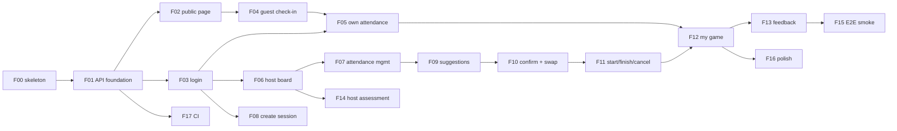

# FairCourt MVP roadmap

Status: PROPOSED (2026-11-17). Sprint content follows the blueprint §17 build order; open decisions below need the owner.
Board: [README.md](README.md) · System design: [architecture/system-design.md](architecture/system-design.md)

## 1. Where the project is (repository scan, 2026-11-17)

| Area | What exists | What does not exist yet |
|---|---|---|
| Infra | `compose.yaml` (postgres 18.6, backend, frontend; `test` and `tools` profiles), opt-in `compose.backend-dev.yaml`, ports 9090–9093, pinned versions (README) | CI workflow |
| Database | `V1__initial_schema.sql` copied verbatim from §12 | No further migrations |
| Backend | `SecurityConfig` (health public, everything else `denyAll`, CSRF on), `ClockConfig`, `LocalDemoSeeder` (JdbcClient, idempotent, one transaction), `PublicCodeGenerator`, pure `matching/` package (`MatchSuggester`, `BoardSnapshot`, `Proposal`, `ReasonCode`, `Warning`, `SuggestionResult`) | No controllers, services, entities, repositories, error handling, login, guest access |
| Backend tests | `MatchSuggesterTest` (13 cases incl. all §14 boundary tests), `DatabaseSchemaIT` (seed idempotency, busy-court and unreleased-player indexes), context test | Authorization / API integration tests |
| Frontend | Vite + React 19 + Tailwind 4 tokens (`tokens.css` `@theme`), one `HomePage` at `/` | Router, API client, any §16 route, shared components |
| Docs | README (run/test/format/verification log), `API Document/backend.md` + `frontend.md` (status per route = "Not started") | — |

The README verification log shows slice 1 verified on the Mac (2026-11-09) and on Windows WSL (2026-11-12). Nothing was re-run for this roadmap.

## 2. Research: what similar products do

Sources are app-store listings, vendor help pages and marketing pages, so their claims are the vendors' and were not tested. Fetched 2026-11-17.

| Product | What it does that is relevant | Source |
|---|---|---|
| PaQueueKa (iOS) | Host creates a session; players join by a 6-character code or QR without an account; matches built by skill tier, recent partners mixed up, fewer rematches vs. same opponents; finished players go to the back of the queue; late joiners do not jump ahead; host or player can "sit out" without losing their place; queue sortable by "Longest wait", players waiting 20+ min are tagged; host can edit lineups mid-match and fix a skill tier; rotation modes (balanced, FIFO, challenger court); scores, rankings, fees, badges, tournaments in paid tiers | [App Store](https://apps.apple.com/jp/app/paqueueka-badminton-queue/id6770977347) |
| BRL – Badminton Ready List (iPad) | Players check in as "Ready for Game"; sorted by arrival time or break duration; tracks match counts "so everyone gets an equal chance"; suggests the next group | [App Store](https://apps.apple.com/us/app/-/id6608966866) |
| Badminqueue 2 (iPad) | Chooses next players per court, sorts by match count, can match by level and gender; v1.0.4 moved queue logic to a percentage basis and added an on-court timer (search summary; the listing page itself returned 404 when fetched) | [App Store](https://apps.apple.com/no/app/badminqueue-2/id6466697521) |
| Reclub | Clubs with host-run sessions, RSVP, join requests, placeholder "reserve" for players without the app; skill split by court is a club convention, ratings via DUPR integration for pickleball | [Help center](https://help.reclub.co/hc/reclub-help/en/categories/reclub), [FAQ](https://pickleball.reclub.co/faq), [Hosting tips](https://pickleball.reclub.co/blog/10-insider-secrets-to-hosting) |
| Playtomic | Starting level from a one-time questionnaire, explicitly "an estimate"; a reliability indicator (low/medium/high) that starts low; a level set in a certified club session starts at medium reliability | [Level system](https://playerhelp.playtomic.com/hc/en-gb/articles/43310980754193-How-the-Playtomic-level-system-works), [Reliability](https://intercom.help/getplaytomic/es/articles/8625153-the-level-reliability-variation) |
| Reclub community survey (Indonesia padel, 2026) | Reports that only 9% of respondents trust their own self-assessment as the single rating method (single regional sample) | [Survey](https://coolmeets.reclub.co/research/padel-ratings-indonesia-2026-results) |
| PB League (pickleball league) | Weighted pairing optimizer (session partners, sit-outs, sit-out variance, opponents, rank balance, ...); admin can rerun, regenerate part of a round, and edit any pairing manually before "lock & save" | [Feature page](https://pb-league.github.io/league/marketing.html) |
| Padel Americano/Mexicano apps | Americano = everyone partners everyone; Mexicano = standings drive pairings; at least one listing summary reports user complaints about repeated partners and unequal game counts | [Padelmix](https://mwm.ai/apps/padel-americano-padelmix/6505054587), [Americano Padel](https://apps.apple.com/app/id1536633475) |
| Open-source | Court-assignment prototype in Java (no skill balancing seen), a Docker+PostgreSQL badminton tournament planner, an open rating engine | [Badminton-Algorithm-java](https://github.com/Reinyerr/Badminton-Algorithm---java), [tournament planner](https://mfuglsang.github.io/badminton_tournament_planner/?lang=en), [OpenRating](https://badminton.openrating.app) |

### What this means for FairCourt

Already in the blueprint, and the research supports it (no change needed):

- Join by code without an account → guest check-in (§3, §12). A shared code alone is never identity in FairCourt (§3); PaQueueKa's listing does not say how it handles that.
- "Games played first, then waited longest" is what BRL, Badminqueue and PaQueueKa describe → §14 selection order.
- Visible waiting time → `WaitIndicator` (§6). The "tag after N minutes" threshold is not in the blueprint → OD-14.
- Avoid repeat partners → §14 split ranking.
- Human review before saving (PB League "lock & save", PaQueueKa edit lineup) → suggest → swap → confirm (§5, §13).
- A self-assessment is only a starting estimate (Playtomic; 9% trust figure) → provisional band + `SELF_REPORTED → OBSERVED → CONFIRMED` + host observation (§4, F14).

Gaps the research exposed in the blueprint (added as open decisions, not decided here):

- "Sit out without losing your place" vs. FairCourt's `READY ↔ RESTING`: the blueprint does not say whether `available_since` is kept or reset → OD-07.
- Rejecting a pending guest: the §11 state diagram has no `PENDING → LEFT` → OD-15.

Ideas kept for after the MVP pilot (see §6): QR code for the public link, repeat-opponent penalty, rotation modes, fixed pairs, self-service sit-out, offline-tolerant host actions, host-assisted check-in for people without a phone. Fees, rankings, badges, tournaments and mini games stay out (§3 "Explicitly later").

## 3. Planning principles

1. **Runnable vertical slices** (§8): every sprint ends with something demoable through the real UI or HTTP API, tests green, stack starting with `docker compose up --build -d`.
2. **Easy → hard, inside dependency order**: read-only before writes, anonymous before authenticated, single-row writes before multi-row transactions. The hardest feature (F10 confirm) comes after the plumbing it needs is proven.
3. **Foundation once, reuse everywhere**: F01/F02 build error handling, the security route table, the test harness, the API client and the async-state hooks. Later features add a route line, a DTO, a query or service, and test rows; they do not edit the plumbing.
4. **Additive change**: new behavior = new classes, new migration `V<n>`, new rows in `AccessMatrixIT`. Never widen one audience's DTO to serve another (§13).
5. **Privacy first**: each read endpoint selects only the columns its audience may see; tests check response keys against an allowlist (system-design §6, §12).
6. **Decisions before code**: anything the blueprint does not decide becomes an `OD-xx` and blocks only the feature that needs it.

## 4. Sprint plan

Timebox per sprint is the owner's call. Blueprint §8 estimates the whole MVP at 4–6 weeks of part-time evenings (an estimate, not a commitment). Difficulty is my estimate.

| Sprint | Features | Difficulty | Blueprint | Gate |
|---|---|---|---|---|
| S00 Foundation | F00 | — | §0, §12, §14, §17-1 | Deterministic two-court proposal, no duplicate players — **DONE** |
| S01 Public read | F01 API foundation, F02 Public session page | Easy | §0, §13, §16 | Anonymous sees only public data; errors and CSRF bootstrap tested |
| S02 Identity | F03 Account login, F04 Guest check-in, F05 Own attendance + member join | Medium | §11, §12, §13, §15 | Anonymous sees only public data; guest sees only own state (§17-2) |
| S03 Host board | F06 Host board, F07 Attendance management, F08 Create session | Medium | §3, §6, §11, §13 | Host creates a session, approves a guest, sees the full board; another account gets 403 |
| S04 Match loop | F09 Suggestions, F10 Confirm + swap, F11 Start/finish/cancel | Hard | §5, §11, §12, §14, §15 | Correct DB state, 409 on unavailable player/court, no partial rows (§17-3) |
| S05 Player loop | F12 My game, F13 Feedback, F14 Host assessment | Medium | §4, §13, §16 | Four assigned players see only their own match/court; a fifth sees none (§17-4) |
| S06 Acceptance | F15 E2E smoke, F16 Responsive/a11y, F17 CI | Medium | §0, §6, §16, §17-5 | All six §0 steps and the §17 checklist PASS with evidence |

Mapping to §17: step 1 = S00; step 2 = S01 + S02 + guest approval in F07 (approval needs the host identity and board, so it lands in S03); step 3 = S04; step 4 = S05; step 5 = S06 (local part; private deployment and a real session are in the later backlog). The order of the §17 gates is unchanged.

F14 (host assessment) and F17 (CI) have few dependencies and can be pulled earlier if a sprint has room.

## 5. Open decisions

Each decision blocks only the features listed. "Recommended" is a proposal; nothing here is decided until the owner says so and it is logged in the feature's decision log (and in `CLAUDE.md` if project-wide).

| ID | Question | Options | Recommended | Blocks |
|---|---|---|---|---|
| OD-01 | Frontend routing for the §16 routes | (a) add `react-router` (exact version checked on npm at implementation time) · (b) small in-house router on `history.pushState` | (a): guards, params and nested host routes without custom code | F02 |
| OD-02 | How does the browser learn `sessionId` for `/my/sessions/:sessionId`, `GET /sessions/{id}/me` and `POST /sessions/{id}/join`? §13's public response forbids "names or match IDs" and the guest-join example body has no `sessionId` | (a) add `sessionId` to the public summary · (b) only return it from guest/member join · (c) key player routes by `publicCode` (changes §16 routes) | (a): an opaque UUID grants nothing because every private route checks identity; members need it before joining, so (b) alone is not enough | F02, F04, F05 |
| OD-03 | Login screen route and where a host lands after login (§16 names no login route) | (a) `/login?next=…`, back to `next` or home · (b) login dialog on the home page | (a) | F03 |
| OD-04 | How a host reaches `/host/sessions/:id`. §13 has no "my sessions" route | (a) new `GET /api/v1/host/sessions` (sessions hosted by the caller) · (b) public page shows a Manage link when the caller is the host (adds a field to the public DTO) · (c) URL only from seed log / bookmark | (a): host-only, no player data, keeps the public DTO unchanged | F06 |
| OD-05 | Create-session UI: §3 step 1 and §13 `POST /sessions` exist, but §6/§16 have no screen | (a) API + tests only in MVP · (b) small form at `/host/sessions/new` | (b) if the pilot host will create real sessions; otherwise (a) | F08 |
| OD-06 | Guest cookie lifetime: "expire it shortly after the session" (§12) | `ends_at` + N hours (N = ?) | `ends_at + 12h` as a starting value | F04 |
| OD-07 | `available_since` rules the blueprint leaves open: on `RESTING → READY`, on guest approval `PENDING → READY`, and on cancel | keep the earlier value vs. reset to now, per transition | Approval: keep join time. Resting → ready: keep (PaQueueKa-style "sit out without losing your place"). Cancel: keep (the players did not play) | F07, F11 |
| OD-08 | Frontend/browser test tooling | (a) none in MVP; HTTP-level smoke test in Java (no new dependency) · (b) add Vitest for pure UI logic (swap reducer) · (c) add Playwright for a phone-viewport browser test (§7 mentions one) | (a) now, (b) when F10 lands, (c) optional in F15 | F10, F15 |
| OD-09 | CI: add a GitHub Actions workflow (§7, §17 say CI runs backend tests and frontend build) | approve file + scope | Approve, tests + build only, no deploy | F17 |
| OD-10 | Closing a session (`OPEN → CLOSED`): §11 defines closed behavior, §13 has no route | (a) out of MVP; only seed/DB sets CLOSED, services still enforce read-only · (b) add a host route | (a) | F02, F08–F11 |
| OD-11 | May the host also play in their own session? Seed host has no player profile | (a) no in MVP · (b) yes, host joins as member | (a) | F05, F06 |
| OD-12 | Version label: title says v0.4, Part II says v0.3 (existing open question in `CLAUDE.md`) | — | — | none |
| OD-13 | What the public page's `Join session` button does before guest check-in (F04) ships | (a) visible but disabled with "Coming soon" (same pattern as the home page's Host login) · (b) hidden until F04 | (a) | F02 |
| OD-14 | Wait indicator on the host board: minutes only, or a highlight after N minutes? | minutes only · highlight after N | Minutes only in MVP | F06 |
| OD-15 | Can the host reject a pending guest (`PENDING → LEFT`)? Not in the §11 diagram | allow · do not allow | Allow, so a mistaken or duplicate check-in can be cleared | F07 |
| OD-16 | How does a player learn the `matchId` that `POST /sessions/{id}/me/feedback` requires? `/me` lists `matchNo`, `courtNo`, `matchState` only | (a) add own `matchId` to the `/me` assignment · (b) feedback body uses `matchNo` instead | (a): it is the caller's own match | F12, F13 |

## 6. Later backlog (not scheduled)

Nothing here enters a sprint without an owner decision. IDs are stable.

| ID | Idea | Origin |
|---|---|---|
| L-01 | Private pilot deployment + one real session (§8 milestone 4, §17 step 5) | Blueprint |
| L-02 | Installable PWA; offline-tolerant host actions | Blueprint §7, PaQueueKa |
| L-03 | Vietnamese UI copy | Blueprint §6 |
| L-04 | QR code for the public session link | PaQueueKa |
| L-05 | Repeat-opponent penalty in the matcher | PaQueueKa, PB League |
| L-06 | Rotation modes (FIFO, challenger court) as alternative policies | PaQueueKa |
| L-07 | Fixed pairs that always play together | PaQueueKa "bonded pairs", blueprint §5 "manual pairings" |
| L-08 | Player self-service sit-out | PaQueueKa |
| L-09 | Host-assisted check-in for people without a phone | Blueprint §3 "Can assist", Reclub "reserve" |
| L-10 | Close-session route (if OD-10 = later) | Blueprint §11 |
| L-11 | Account verification/recovery and abuse controls before public signup | Blueprint §15 |
| L-12 | Modules 2–4: recurring sessions/RSVP, live tournament, swing review | Blueprint §2 |

## 7. Risks

| Risk | Effect | Mitigation |
|---|---|---|
| Spring Boot 4 / Spring Security 7 are newer than most tutorials | Wrong API usage copied from older examples | Check the official reference for each API; integration tests prove the behavior |
| CSRF token changes after login/logout | SPA writes fail with 403 after login | Client fetches a new token after login/logout and retries once on `CSRF_TOKEN_INVALID` (F01, F03) |
| Double tap / two host tabs on confirm | Duplicate or half-written match | Session row lock + partial unique indexes + 409 (F10) |
| Repo on `/mnt/d` under WSL | Slow file watching | Already handled with `VITE_USE_POLLING` and DevTools polling |
| Research ideas creeping into the MVP | Scope growth | Later backlog only; `scope-guardian` review per feature |
