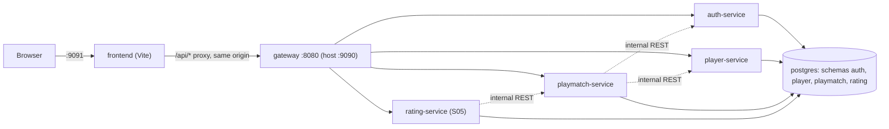

# FairCourt system design (MVP, microservices)

Status: PROPOSED (rewritten 2026-11-17 after OD-17 = microservices). Every `AD-xx` referenced here is in [decisions.md](decisions.md) and needs owner approval. Product rules still come from the blueprint (§3–§17); this document only changes **how the backend is deployed and split**, not what the product does. Owner decisions that change the product (singles/doubles, price, minimum sets) are OD-18…OD-21 in [ROADMAP.md](../ROADMAP.md#5-open-decisions).

Not verified yet: which Spring Cloud release supports Spring Boot 4.1.2, and how much RAM the stack needs. Both are checked in F18 before any version is pinned.

## 1. Forces that shape the design

| Force | Source | Design consequence |
|---|---|---|
| Learn microservices by building them | Owner, OD-17 | Real service boundaries, real network calls, one database container to keep laptops light |
| Player data stays private; host actions are host-only | §0, §3 | Only the gateway faces the browser; identity is resolved once there and passed on in a signed form; one DTO per audience; allowlist tests |
| No half-written match, no player or court used twice | §12, §15 | Everything that must change together (session, attendance, matches) lives in **one** service with one local transaction |
| Runs unchanged on Mac (arm64) and Windows WSL | CLAUDE.md | Docker Compose only; no Kubernetes; no `platform:` pins |
| Future: real-time court map, chat, notifications, discovery | Owner, L-13…L-18 | Event names are defined now; Kafka is added when the first consumer exists (AD-17) |
| Later features add code instead of rewriting old code | Owner | Shared libraries for plumbing; a new service is a new folder |

## 2. Service map

| Service | Owns (schema → tables) | Responsibility | Built in |
|---|---|---|---|
| `gateway` | none | The only component the browser talks to. Route table (deny by default), HTTP session cookie, CSRF, guest cookie, request ID, identity token for services | S01 (routes), S02 (identity) |
| `auth-service` | `auth` → `app_user`, `guest_access` | Check email + password, issue and resolve guest credentials | S01 shell, S02 logic |
| `player-service` | `player` → `player_profile`, `skill_assessment` | Player profiles (member and guest), self-reported and host-assessed bands | S01 shell, S02/S05 logic |
| `playmatch-service` | `playmatch` → `play_session`, `attendance`, `play_match`, `match_player` | Play sessions (incl. singles/doubles, price per person, minimum sets), attendance, host board, suggestions (uses the `matching` library), confirm/start/finish/cancel | S01 |
| `rating-service` | `rating` → `match_feedback` | Match-fit feedback; later Elo, rankings, peer voting | S05 |

Later, not designed yet: `notification-service`, `venue-service`, `discovery` (list + map), `chat-service`, `storage-service` (L-13…L-19).

### Why `playmatch-service` holds session + attendance + matches

Confirming a match (§15) must, in **one** step: lock the session, check that 2 or 4 players are `READY` and the court is free, create the match, and mark the players `ASSIGNED`. If attendance and matches lived in two services, that step would need a saga across the network, the "no player in two matches" guarantee would no longer come from database constraints, and every confirm would be slower. Splitting by **what changes together** keeps the hardest rule simple.



Only `gateway` (and the frontend) publish host ports. Services are reachable only on the Compose network. Host ports stay in the 9090+ range (9090 gateway, 9091 frontend, 9092 debug, 9093 PostgreSQL); per-service debug ports, if needed, get new numbers from 9094 with owner approval.

Every service can be started, rebuilt, stopped and followed in the logs on its own (owner request 2026-11-17). Services depend only on PostgreSQL in Compose; the gateway does not wait for them (a missing service answers `503` through the gateway). Commands are in F18 design §6 and, after F18, in the README.

## 3. Repository layout (AD-13)

```text
compose.yaml  .env.example  README.md
backend/
  pom.xml                       parent + aggregator (versions pinned once)
  Dockerfile                    one file; build arg MODULE selects the service
  libs/
    common-web/                 ApiError, ErrorCode, ApiException, GlobalExceptionHandler,
                                RequestIdFilter, internal identity token (S02), test support
    matching/                   pure matcher (moved from today's backend, unchanged behavior)
  services/
    gateway/
    auth-service/
    player-service/
    playmatch-service/
    rating-service/             (S05)
frontend/                       unchanged, proxies /api to the gateway
```

A Maven multi-module build compiles the libraries once and every service depends on them. One `mvn verify` still runs all tests, so the pre-commit pipeline keeps one command.

## 4. Data: one container, one schema per service (AD-12)

- One PostgreSQL container, one database `faircourt` (tests: `faircourt_test`), **one schema per service**, **one shared DB user** (owner decision 2026-11-17).
- Each service runs its own Flyway on its own schema with its own history table. A service never reads or writes another schema; it calls that service instead.
- No foreign keys across schemas. A reference to another service's row is a plain UUID column (e.g. `attendance.player_id`), checked by calling the owning service when it is created.
- Because the DB user is shared, the database does not block a wrong cross-schema query. A test in every service fails the build if its SQL or migrations mention another service's schema name.

### Where the blueprint §12 tables go

| Table | Schema | Change from the blueprint V1 |
|---|---|---|
| `app_user` | `auth` | none |
| `guest_access` | `auth` | FK to `attendance` becomes plain `session_id` + `attendance_id` UUIDs |
| `player_profile` | `player` | FK to `app_user` becomes plain `user_id` |
| `skill_assessment` | `player` | `session_id`, `reviewer_user_id` become plain UUIDs |
| `play_session` | `playmatch` | `host_user_id` plain UUID; **new** `match_format` (`SINGLES`/`DOUBLES`, OD-20), `min_sets` (default 6, 1–20, OD-19), price per person by gender as a range: `price_male_min_vnd`, `price_male_max_vnd`, `price_female_min_vnd`, `price_female_max_vnd` (optional, shown only, OD-18) |
| `attendance` | `playmatch` | `player_id` plain UUID; **new** `display_name` copied at join (so the host board does not call player-service for names) |
| `play_match`, `match_player` | `playmatch` | none (singles uses one player per team) |
| `match_feedback` | `rating` | FK to `match_player` removed; the participant check is a call to playmatch-service |

Exact columns, defaults and limits are fixed in the F18 design. `attendance.games_played` already exists and is the "sets played" counter (OD-19: 1 set = 1 match).

## 5. Request pipeline and identity (AD-14)

```mermaid
sequenceDiagram
    participant C as Browser
    participant G as gateway
    participant A as auth-service
    participant S as target service
    C->>G: /api/v1/... (cookies)
    G->>G: requestId; route rule (deny by default); CSRF on writes
    alt account session cookie
        G->>G: userId from the gateway's HTTP session
    else guest cookie
        G->>A: resolve guest credential (hash lookup)
        A-->>G: guestAccessId, sessionId, attendanceId or "expired"
    end
    G->>S: request + X-Request-Id + signed identity token (short-lived)
    S->>S: verify token → CallerIdentity; service-level checks (AccessPolicy)
    S-->>G: response or ApiError
    G-->>C: same body
```

- The browser only ever holds HttpOnly cookies (account session, guest credential). Tokens never reach JavaScript (§16).
- The gateway removes any identity or request-ID header sent by the browser before forwarding, so a client cannot pretend to be someone.
- Services accept identity **only** from the signed token. The token format (signed JWT vs. plain header on the private network) is decided in the F03 design. S01 needs no identity (public reads only).
- Login (F03): the gateway sends the credentials to `auth-service`, receives a `userId`, and stores it in its own HTTP session. Later account requests need no call to auth-service.
- The service-level host check from §15 still runs inside `playmatch-service` for every host mutation; the gateway route rule is only the first gate.
- CSRF stays on at the gateway, the only place that accepts cookies (§0). Services do not see browser cookies.

## 6. Communication between services

| Kind | Now (MVP) | Later |
|---|---|---|
| Query another service | Synchronous REST on `/internal/v1/**` over the Compose network; the gateway never routes `/internal/**`; short timeouts | Same, or a local copy fed by events |
| Tell others something happened | Not needed in S01–S06 | Kafka topics with the event names below (AD-17) |

Internal routes are new API surface beyond §13, so each one is listed in its feature design and needs owner approval (rule: no unapproved endpoints).

When a called service is down: the caller returns `503 SERVICE_UNAVAILABLE` with the standard error body. Writes are never retried automatically.

### Event names reserved for Kafka (no Kafka in S01–S06)

| Event | Producer | First consumer (later) |
|---|---|---|
| `MatchStarted`, `MatchFinished` | playmatch-service | notification-service ("your turn, court 2"), real-time court map (L-14), rating-service |
| `AttendanceChanged` | playmatch-service | court map (people per session) |
| `PlayerBandChanged` | player-service | playmatch-service local copy of bands |

When Kafka arrives, events are written with a transactional outbox (row in the producer's schema in the same transaction, then published), so an event is never lost or sent for a rolled-back change.

## 7. Flows that cross services

| Flow | Services | How | Failure handling |
|---|---|---|---|
| Public session page (F02) | gateway → playmatch | One read | — |
| Login (F03) | gateway → auth | Verify credentials; gateway session | Wrong password → 401 |
| Guest check-in (F04) | gateway → playmatch → player, auth | **playmatch orchestrates**: create guest profile (player), create `PENDING` attendance (local transaction), ask auth for a guest credential, gateway sets the cookie | If auth fails after the attendance exists: mark that attendance `LEFT` (compensation) and return 503. This is the first saga in the project (AD-16) |
| Member join (F05) | playmatch → player | Look up the member's profile by `userId`, copy `display_name` | 503 if player-service is down |
| Host board, suggestions (F06, F09) | playmatch → player | One batch call for the bands of everyone in the pool | 503; no partial board |
| Confirm / start / finish / cancel (F10, F11) | playmatch only | One local transaction, session row lock, unique-index backstop (AD-07) | 409 `MATCH_CONFLICT`, nothing written |
| Feedback (F13) | rating → playmatch | Ask playmatch whether the caller played that finished match, then store | 503; duplicate → 409 |
| Host assessment (F14) | player (host check via playmatch) | player-service asks playmatch "is this caller the host of this session?" | 403 / 503 |

## 8. Inside a service

The patterns of the earlier design still apply **inside** each service:

- Thin controllers, one `@Transactional` command per write, `CallerIdentity` as the only identity source.
- CQRS-lite (AD-02): JPA for writes, `JdbcClient` read queries that select only the columns the audience may see.
- State transitions in one enum per state machine (AD-03): `AttendanceState`, `MatchState` live in playmatch-service.
- Match commands lock the `play_session` row and rely on partial unique indexes as a backstop (AD-07).
- `matching` stays pure (AD-10). Singles vs. doubles reaches it as a team size in the snapshot (AD-19); detailed in F09.

Module packages inside a service follow its responsibilities, e.g. `playmatch-service`: `session`, `attendance`, `match`, `board`.

## 9. Error model (AD-04, shared in `common-web`)

Body everywhere: `{"code":"…","message":"…","requestId":"…"}`.

| Code | HTTP | When |
|---|---|---|
| `VALIDATION_FAILED` | 400 | Invalid body, path or query |
| `UNAUTHENTICATED` | 401 | No account session / no valid guest cookie |
| `GUEST_ACCESS_EXPIRED` | 401 | Guest cookie expired or revoked |
| `CSRF_TOKEN_INVALID` | 403 | Missing or stale CSRF token (gateway) |
| `FORBIDDEN` | 403 | Signed in but not allowed |
| `NOT_FOUND` | 404 | Unknown, or private and not visible |
| `METHOD_NOT_ALLOWED` | 405 | Wrong HTTP method |
| `MATCH_CONFLICT` | 409 | Player or court no longer available at confirm (§13) |
| `STATE_CONFLICT` | 409 | Illegal transition, closed session, duplicate feedback |
| `INTERNAL_ERROR` | 500 | Unexpected |
| `SERVICE_UNAVAILABLE` | 503 | **New:** a service needed for the request did not answer in time |

The gateway creates the `requestId`, forwards it as `X-Request-Id`, and every service logs it (MDC). One ID follows a request through all services.

## 10. Frontend

Unchanged from the earlier design (AD-08): `api/client.ts` is the only `fetch` caller; `useAsync` / `useMutation` page states; `lib/status.ts`; copy in `copy/en.ts`; Vite proxies `/api` to the gateway, so the browser still sees one origin. Work order per feature: backend first, then that feature's frontend, before the next feature (owner decision 2026-11-17).

## 11. Testing strategy

| Layer | What | Where |
|---|---|---|
| Unit | Matcher, value objects, state enums | each lib/service |
| Service integration | Controllers + DB against the service's schema in `faircourt_test`, identity given as a test token | `*IT.java` per service |
| Gateway integration | Route table, CSRF, JSON 401/403, request ID, 503 when a downstream is down; downstream replaced by a JDK `HttpServer` stub in the test (no new dependency) | gateway `*IT.java` |
| Schema boundary | Each service's SQL and migrations do not mention another service's schema | one test per service |
| Access matrix | Per service: `(route, caller) → status`. End to end: the §0 demo through the gateway with separate cookie jars (F15) | per service + F15 |
| Privacy allowlist | Every non-host response's JSON keys ⊆ allowlist | `JsonAllowlist` in `common-web` test support |

## 12. Pattern catalog

| Pattern | Where | Why | Not used |
|---|---|---|---|
| API gateway / BFF | `gateway` | One origin, cookies and CSRF in one place, services never see browser credentials | No service exposed to the browser directly |
| Database per service (schema variant) | One schema per service | Ownership without one container per service | No cross-schema joins or FKs |
| Split by transaction boundary | `playmatch-service` | Confirm stays one local transaction | No saga for confirm |
| Orchestrated saga + compensation | Guest check-in (F04) | Three owners touched by one user action | No two-phase commit |
| Identity propagation (signed token) | gateway → services | Services trust one signed value, not client headers | No client-provided IDs as identity (§13) |
| Shared kernel library | `common-web`, `matching` | One error shape; pure matcher reused | No business rules or entities in libs |
| Transactional outbox (later) | When Kafka arrives | Events never lost or sent for rolled-back changes | Not in S01–S06 |
| Functional core / imperative shell | `matching` + playmatch match service | Deterministic, testable rules (§14) | — |
| CQRS-lite, state enum, policy object, value objects, discriminated unions | Inside services / frontend | As before (AD-02, AD-03, AD-08) | — |

## 13. What microservices cost here (to learn from, not to hide)

| Area | Single app (blueprint) | This design | Effect |
|---|---|---|---|
| Containers locally | 3 | 7 in S05 (gateway, 4 services, postgres, frontend) | More RAM and slower start; not measured yet |
| Guest check-in | One transaction | Saga with compensation | More code and more failure cases to test |
| Host board / suggestions | One SQL query | Query + one batch call to player-service | One extra network round trip; fails with 503 if player-service is down |
| Tests | One `mvn verify` | Still one `mvn verify` (multi-module), plus gateway stub tests | Slightly longer pipeline |
| Debugging | One log | Logs from several containers, joined by `requestId` | `docker compose logs` filtered by requestId |
| Learning value | Low | High: gateway, identity propagation, saga, later Kafka/outbox | Owner's goal |

## 14. Extension points

| Future need | Where it plugs in |
|---|---|
| Notifications "your turn, court N" | Kafka + `notification-service` consuming `MatchStarted` |
| Real-time court map (L-14) and discovery list (L-18) | New read service fed by `AttendanceChanged` / `MatchStarted` events; venue coordinates from a later `venue-service` |
| Call / chat with the host (L-15, L-16) | Host phone in auth or player profile; `chat-service` with WebSocket |
| Files (L-13) | `storage-service` when the first feature needs files |
| Keycloak (L-17) | Replaces the credential check in `auth-service`; the gateway becomes the OIDC client; services unchanged because they only see the identity token |
| Elo / rankings | `rating-service` |
| New matching rules (L-05, L-06) | `matching` library |
