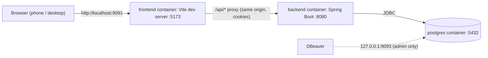
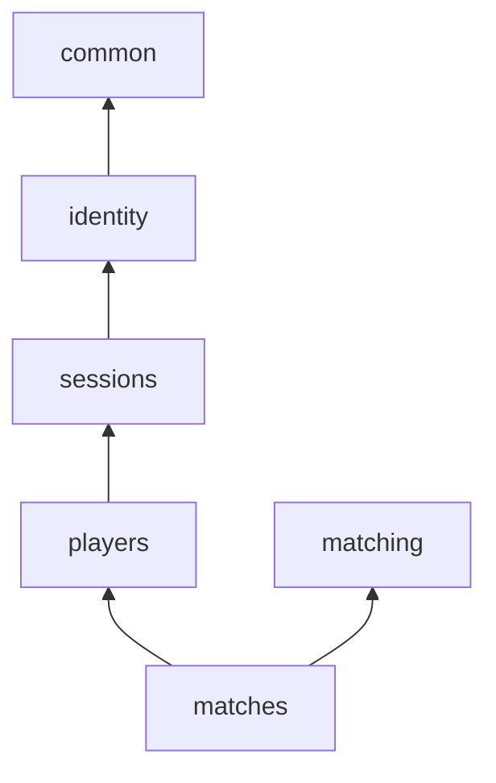

# FairCourt system design (MVP)

Status: PROPOSED (2026-11-17). The decisions referenced as `AD-xx` are listed in [decisions.md](decisions.md) and need owner approval. The blueprint wins on any conflict; this document only fills in how to build what §11–17 specify.

## 1. Forces that shape the design

| Force | Source | Design consequence |
|---|---|---|
| Player data stays private; host actions are host-only, "even if a shortcut would make the demo easier" | §0, §3 | Identity from principal or guest cookie only; one access policy; one DTO per audience; allowlist tests |
| No half-written match, no player or court used twice | §12, §15 | One transaction per match command; session row lock; partial unique indexes as backstop; 409 on conflict |
| Rules must be explainable and testable | §5, §14 | Pure matcher behind a snapshot; state transitions in one place per state machine |
| Boring, one deployable, small pilot | §7 | Modular monolith, REST, polling; no Redis/Kafka/WebSocket |
| Owner goal: later features should add code, not rewrite old code | owner | Plumbing built once in F01/F02; features add a route line, a DTO, a query/service and test rows |

## 2. Runtime view



Host ports: frontend 9091, backend 9090, JDWP 9092, PostgreSQL 9093 (owner decisions 2026-11-12/13). The browser only talks to the Vite origin; `/api` is proxied, so cookies and CSRF behave as same-origin (§0).

## 3. Backend modules

The packages are the §15 code map. Each module owns its tables for writes.

| Package | Owns (writes) | Responsibility |
|---|---|---|
| `common` | — | `ApiError`, `ErrorCode`, `ApiException`, `GlobalExceptionHandler`, `RequestIdFilter`, `ClockConfig`, local seed |
| `identity` | `app_user`, `guest_access` | `SecurityConfig` route table, account login, guest cookie issue/resolve, `CallerIdentity`, `AccessPolicy`, CSRF bootstrap |
| `sessions` | `play_session` | Create session, public summary, host board read model, public code |
| `players` | `player_profile`, `attendance`, `skill_assessment` | Guest check-in, member join, own attendance (`/me`), attendance state changes, host assessment |
| `matching` | — (pure) | `MatchSuggester(BoardSnapshot) → SuggestionResult`; no Spring, no DB |
| `matches` | `play_match`, `match_player`, `match_feedback` | Suggestions endpoint (builds the snapshot), confirm/start/finish/cancel, feedback |

Dependency direction (no cycles; `matching` depends on nothing):



Rules (AD-01):
- A module writes only its own tables, through its own service. Another module calls that service; it never updates those tables itself.
- Read models may join across tables (they are read-only SQL; see §6).
- `matching` stays pure: input `BoardSnapshot`, output `SuggestionResult`. `matches/BoardSnapshotAssembler` converts DB rows to the snapshot (anti-corruption layer).

## 4. Request pipeline

```mermaid
sequenceDiagram
    participant C as Browser
    participant F as RequestIdFilter
    participant SEC as Spring Security
    participant CTL as Controller
    participant SVC as Service / Query
    participant DB as PostgreSQL
    C->>F: HTTP /api/v1/...
    F->>F: requestId → MDC
    F->>SEC: 
    SEC->>SEC: account session or guest cookie → Authentication
    SEC->>SEC: CSRF check on writes; route rule (first gate)
    SEC->>CTL: 
    CTL->>CTL: validate request DTO (@Valid) → 400
    CTL->>SVC: call with CallerIdentity + path IDs + request
    SVC->>SVC: AccessPolicy (second gate, resource-specific)
    SVC->>DB: transaction / read query
    SVC-->>CTL: result record
    CTL-->>C: audience-specific response DTO
    Note over SEC,CTL: Any failure → ApiError {code, message, requestId}
```

- Spring Security route rules are the first gate; the service-level ownership check is the second and runs for every host mutation (§15).
- Security failures (401/403, CSRF) are written as `ApiError` JSON by the security entry point and access-denied handler, so the frontend sees one error shape everywhere (AD-04).

## 5. Identity model

```java
// identity/CallerIdentity.java (sketch)
public sealed interface CallerIdentity {
    record Anonymous() implements CallerIdentity {}
    record Account(UUID userId) implements CallerIdentity {}
    record Guest(UUID guestAccessId, UUID sessionId, UUID attendanceId) implements CallerIdentity {}
}
```

- **Account**: email + password login creates a server-side HTTP session (HttpOnly, SameSite=Lax, `Secure` from `COOKIE_SECURE`) (§13, §15). F03.
- **Guest**: a filter on the guest-capable paths reads the guest cookie, hashes it with SHA-256, looks up `guest_access` (not revoked, not expired) and sets a guest authentication. Expired or revoked → `401 GUEST_ACCESS_EXPIRED`; unknown → anonymous. The raw secret is never stored or logged (§12). F04.
- Controllers receive a `CallerIdentity` from one argument resolver. Services `switch` over it; the sealed type makes the compiler list every case (AD-05).
- A guest identity is valid only for its own `sessionId`; a guest calling another session's `/me` gets 404.
- If one browser has both an account session and a guest cookie, the account wins (documented in F05 design).

Access policy (§11, §15):

```text
AccessPolicy.requireHost(caller, sessionId):
  session missing                      → 404 NOT_FOUND
  caller is Anonymous                  → 401 UNAUTHENTICATED
  caller is Guest, or Account ≠ host   → 403 FORBIDDEN
For /host/matches/{matchId}/...: resolve sessionId from the match first (unknown match → 404).
```

## 6. Write side vs. read side (CQRS-lite)

| Side | Technology | Used for | Why |
|---|---|---|---|
| Write (commands) | Spring Data JPA entities + repositories inside the owning module | create session, join, check-in, attendance transitions, confirm/start/finish/cancel, feedback, assessment | Entity methods enforce state transitions; `@Lock` for row locks; §7 says JPA for routine CRUD |
| Read (queries) | `JdbcClient` SQL in `*Query` classes that return the response record directly | public summary, `/me`, host board, snapshot for the matcher | The SQL selects only the columns that audience may see, so a privacy leak needs a SQL change, not just a forgotten field; no N+1 loading; no entities leave persistence |

The existing seed already uses `JdbcClient`. Entities are never returned from controllers (§15). (AD-02)

## 7. State machines

Transitions live in one enum per machine; entity methods call it; an illegal transition throws `ApiException(STATE_CONFLICT)` → 409 (AD-03).

```java
// players/AttendanceState.java (sketch of the §11 diagram)
public enum AttendanceState {
    PENDING, READY, ASSIGNED, PLAYING, RESTING, LEFT;

    private static final Map<AttendanceState, Set<AttendanceState>> NEXT = Map.of(
            PENDING, Set.of(READY),                 // + LEFT only if OD-15 approves
            READY, Set.of(ASSIGNED, RESTING, LEFT),
            ASSIGNED, Set.of(PLAYING, READY),       // READY = planned match cancelled
            PLAYING, Set.of(READY),                 // finish or cancel
            RESTING, Set.of(READY),
            LEFT, Set.of());

    public void requireTransitionTo(AttendanceState target) { ... }
}
```

| Machine | States | Transitions (§11) | Owner |
|---|---|---|---|
| Attendance | PENDING, READY, ASSIGNED, PLAYING, RESTING, LEFT | as above | `players` |
| Match | PLANNED, ACTIVE, FINISHED, CANCELLED | PLANNED→ACTIVE→FINISHED; PLANNED→CANCELLED; ACTIVE→CANCELLED | `matches` |
| Session | OPEN, CLOSED | no route in §13 (OD-10); CLOSED blocks new assignments | `sessions` |

Enum constants match the DB `CHECK` values exactly, and the frontend string unions match them too.

## 8. Transactions and concurrency (match confirm)

```mermaid
sequenceDiagram
    participant H as Host
    participant MS as MatchService.confirm (@Transactional)
    participant DB as PostgreSQL
    H->>MS: courtNo + teams A/B (4 attendance IDs)
    MS->>MS: MatchLineup value object: 4 distinct IDs, 2 per team → else 400
    MS->>DB: SELECT play_session ... FOR UPDATE (serializes confirms per session)
    MS->>MS: AccessPolicy.requireHost; session OPEN; courtNo ≤ court_count
    MS->>DB: re-read the 4 attendance rows (same session, READY) and the court
    alt anyone unavailable or court busy
        MS-->>H: 409 MATCH_CONFLICT (nothing written)
    else ok
        MS->>DB: matchNo = next_match_no; next_match_no + 1
        MS->>DB: INSERT play_match (PLANNED) + 4 match_player
        MS->>DB: 4 attendance → ASSIGNED
        MS->>DB: flush — unique index violation → rollback → 409 MATCH_CONFLICT
        MS-->>H: 201 {matchId, matchNo, courtNo, state: PLANNED}
    end
```

- The session row lock makes concurrent confirms for the same session run one after another; `ux_busy_court` and `ux_player_in_unreleased_match` are the backstop (§12) (AD-07).
- Start/finish/cancel lock the match row, check the match state, and update the match, its four `match_player` rows and four attendance rows in one transaction (§15).
- A uniqueness error is never swallowed: the transaction rolls back and the client gets 409 (§15).

## 9. Error model

Body (§13): `{"code":"MATCH_CONFLICT","message":"A player or court is no longer available.","requestId":"..."}`

Proposed catalog (AD-04). Only `MATCH_CONFLICT` is named in the blueprint; the others need approval.

| Code | HTTP | When | Frontend reaction |
|---|---|---|---|
| `VALIDATION_FAILED` | 400 | Invalid body, path or query | Inline field error |
| `UNAUTHENTICATED` | 401 | No account session / no valid guest cookie | Go to login or public page |
| `GUEST_ACCESS_EXPIRED` | 401 | Guest cookie expired or revoked | "Check in again and tell the host to remove your old entry." (§16) |
| `CSRF_TOKEN_INVALID` | 403 | Missing or stale CSRF token | Fetch a new token, retry once |
| `FORBIDDEN` | 403 | Signed in but not allowed (e.g. not this session's host) | "You don't manage this session" + public page link (§16) |
| `NOT_FOUND` | 404 | Unknown, or private and not visible | Friendly not-found |
| `METHOD_NOT_ALLOWED` | 405 | Wrong HTTP method | Generic error |
| `MATCH_CONFLICT` | 409 | Player or court no longer available at confirm | "This lineup changed. Refresh suggestions" (§16) |
| `STATE_CONFLICT` | 409 | Illegal state transition, closed session, duplicate feedback | Reload the view |
| `INTERNAL_ERROR` | 500 | Unexpected | Generic error with requestId |

Messages are written by us; framework or SQL exception text is never returned. Every request gets a random `requestId` (MDC + error body).

## 10. Frontend architecture

Target layout. §16 lists `api/`, `components/`, `features/`, `routes/`, `styles/`; `hooks/`, `lib/` and `copy/` are additions proposed in AD-08.

```text
frontend/src/
  api/          client.ts (the only place that calls fetch), errors.ts, types.ts,
                sessions.ts, matches.ts
  hooks/        useAsync.ts, useMutation.ts, usePolling.ts
  components/   Button, StatusBadge, EmptyState, ErrorBanner, ConfirmDialog, CourtCard, ...
  features/     home/, public-session/, join/, my-game/, host-board/, match-review/
  routes/       route table + guards (guards improve UX only; the backend enforces access)
  lib/          time.ts (Asia/Ho_Chi_Minh formatting), status.ts (state → label/icon/tone)
  copy/         en.ts (every user-facing string; vi.ts later)
  styles/       tokens.css, globals.css
```

| Concern | Design |
|---|---|
| API client | `api/client.ts`: same-origin `fetch`, JSON, typed `ApiError {status, code, message, requestId}`. Writes fetch the CSRF token from `GET /api/v1/auth/csrf` once, keep it in memory, send it in the documented header, refetch after login/logout and once on `CSRF_TOKEN_INVALID`. Components never call `fetch`. |
| Page state | `useAsync` returns `{status:'loading'} \| {status:'empty'} \| {status:'success', data} \| {status:'error', error}`; `useMutation` returns `idle \| saving \| success \| conflict \| error` (§16 page-state matrix). Pages render with an exhaustive `switch`. |
| Polling | `usePolling(fn, 15_000)` runs only while the page is visible (Page Visibility API) plus a manual Refresh (§16). WebSocket later replaces this hook only. |
| Status display | `lib/status.ts` maps every `AttendanceState` / `MatchState` to `{label, icon, tone}` with a `Record<State, …>`, so a new state is a compile error until mapped. `StatusBadge` always shows text + color (§6). |
| Copy | All user-facing strings in `copy/en.ts`, blueprint copy verbatim; new strings are reviewed in one file (owner rule) and Vietnamese later is a new file (§6). |
| Tap-to-swap | `SwapSelector` logic as a pure reducer (`idle → firstPicked → swapped`), keyboard-operable, no drag-and-drop (§16). |
| Time | API returns ISO-8601 UTC; `lib/time.ts` formats in `Asia/Ho_Chi_Minh` with `Intl.DateTimeFormat` (§12). |
| State library | None; route-local state only (§16). |

## 11. Pattern catalog: where each pattern is used, and where it is not

| Pattern | Where | Why there | Not used |
|---|---|---|---|
| Modular monolith (package per module) | Backend packages (§15) | Clear ownership; a module can be split later | No microservices (§3) |
| Functional core, imperative shell | `matching` (pure) + `matches` service (I/O) | Deterministic, unit-testable rules (§14) | — |
| Anti-corruption assembler | `BoardSnapshotAssembler` | DB shape never leaks into the matcher | — |
| State machine as enum transition table | `AttendanceState`, `MatchState` | §11 rules in one place; consistent 409 | No Spring Statemachine library (too heavy) |
| Value object | `MatchLineup`, `GuestAnswers` (band mapping), `PublicCode` | Invariants checked at construction; unit tests without Spring | Not for every primitive |
| Application service, one transaction per command | `MatchService.confirm/start/finish/cancel`, `AttendanceService` | §15 "single @Transactional method, no partial success" | No event bus in MVP |
| CQRS-lite read projections | `*Query` classes | Privacy by construction; no N+1 | Writes never go through ad-hoc SQL outside the owning module |
| Policy object | `AccessPolicy` | One host-ownership check for every host route (§15) | No global ADMIN role (§11) |
| Sealed type + pattern matching | `CallerIdentity` | Compiler forces member/guest/anonymous handling | — |
| Pessimistic lock + DB constraint backstop | Confirm / lifecycle | Double taps and two tabs | No distributed lock or Redis |
| Error catalog + central handler | `ErrorCode`, `GlobalExceptionHandler`, security handlers | One error shape; frontend maps codes to copy | — |
| Strategy (deferred) | Matching policy | Only when a second policy (L-06) is approved; the snapshot seam already allows it | Not now: one implementation |
| Discriminated unions | `useAsync`, `useMutation`, API error types | The compiler enforces the §16 page states | — |
| Reducer | Tap-to-swap | Pure and testable | — |
| Adapter over transport | `usePolling` | WebSocket later changes one hook | — |
| Object Mother / builder for tests | `support/TestData` | Readable integration-test setup | — |

## 12. Testing strategy

| Layer | What | Where |
|---|---|---|
| Unit | Matcher (existing), value objects, state enums, band mapping | `src/test/.../<module>/*Test.java` |
| PostgreSQL integration | Services and HTTP through MockMvc with real security, against `faircourt_test` | `*IT.java`, run by failsafe in `mvn verify` |
| Access matrix | One parameterized `AccessMatrixIT`: rows `(method, path, caller, expected status)` mirroring the §3 table; every new route adds rows | `api/AccessMatrixIT.java` |
| Privacy allowlist | Public, `/me` and other non-host responses: JSON keys must be a subset of an explicit allowlist | helper `support/JsonAllowlist` |
| Conflict / atomicity | Stale confirm → 409 and row counts unchanged; two concurrent confirms → exactly one succeeds | F10 ITs |
| HTTP smoke | §0 steps 1–5 with separate cookie jars (host, guest, other player, anonymous) over real HTTP | F15 `HostGuestFlowIT` |
| Frontend | `npm run build` (type check) + Prettier; Vitest/Playwright only if OD-08 approves | — |

## 13. Extension points after the MVP

| Future need | Where it plugs in | Existing code touched |
|---|---|---|
| New matching rule (e.g. repeat opponents, L-05) | New field in `BoardSnapshot` + rule in `MatchSuggester` + tests | `matching` + assembler |
| Alternative rotation mode (L-06) | Extract `MatchingPolicy` interface; add a second implementation; host setting picks one | `matching` + one parameter |
| Live updates (module 3) | Replace `usePolling` internals; add a push endpoint | One hook |
| Score entry / tournament (module 3) | New tables via `V<n>` referencing `play_match`; new module package | None in the matcher |
| Recurring sessions / RSVP (module 2) | New module creating `play_session` rows through `SessionService` | `SessionService` gets a new caller |
| Vietnamese UI (L-03) | `copy/vi.ts` + locale switch | Copy module only |
| Pilot deployment (L-01) | `COOKIE_SECURE=true`, same-origin reverse proxy, production profile without the seed | Config only |
